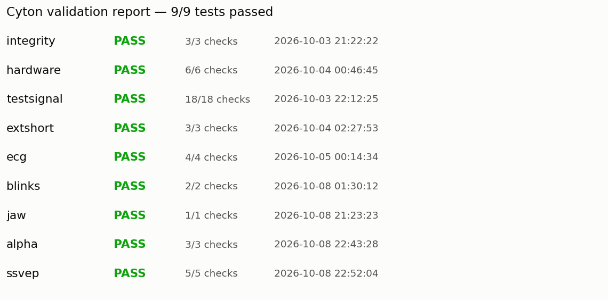
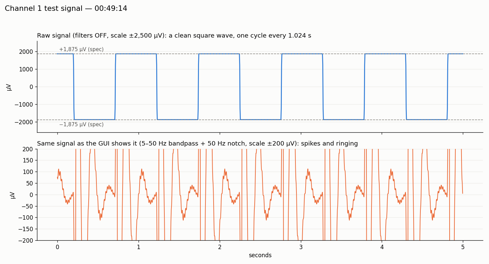
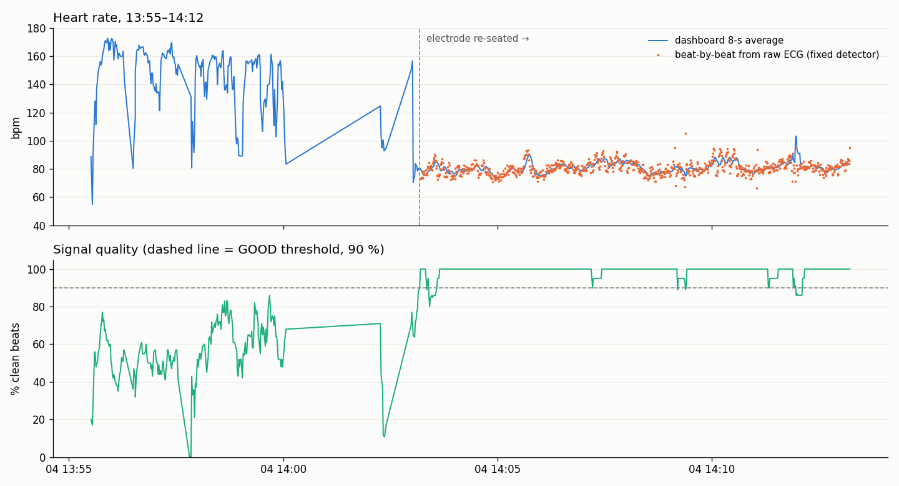

# OpenBCI Cyton validation

Step-by-step proof that an **OpenBCI Cyton** (ADS1299, 8 ch, 250 Hz) records valid signals, as groundwork for a non-invasive EEG motor-imagery BCI. Companion to the PhysioNet classifier work in [braintech-eeg-classification](https://github.com/akshitagarwal123/braintech-eeg-classification).

Full write-up with every test, number, chart and photo: [notes/validation_tracker.md](notes/validation_tracker.md) · daily check-ins: [notes/daily_log.md](notes/daily_log.md)

| Step | Status | Highlights |
|---|---|---|
| 1. Board itself (integrity, noise floor, test signal, external short) | Done | 250 Hz, 0 dropped; 0.10 uV noise floor; test signal ±1,870 uV vs ±1,875 spec; channels match within 0.1 % |
| 2. ECG vs pulse oximeter | Done | Gold: within 1.5 bpm of the oximeter; 810 beats, 100 % clean, SNR 47 on 4 Oct. Dry: within 1.6 bpm of the oximeter, SNR 21; needs a strap for stable contact |
| 3. Blinks, jaw EMG, alpha, SSVEP | Done | Dry electrode: blinks 10/10 on cue; jaw clench 6.8×; **alpha 4.3× with eyes closed (9.5 Hz)**; SSVEP peaks at exactly 12 and 15 Hz (CCA 97 %) |

**Result: 9 of 9 validation tests pass.**

## What is this about?

A brain-computer interface (BCI) reads brain signals from the scalp (EEG) and turns imagined movements into commands. The signals are recorded with an **OpenBCI Cyton**, a small 8-channel amplifier that measures tiny voltages from electrodes on the skin.

Brain signals are only about 10-50 microvolts (uV). Room electricity, movement and loose electrodes easily produce "signals" far bigger than that. Before building anything on this data, two things must be proven:

1. **The board measures correctly**: when it says 100 uV, it is 100 uV, at the right time, on every channel.
2. **The recording is real body or brain activity**, not noise.

**Method:** give the board something whose correct answer is already known and check that it gets it right, with a clear pass/fail rule per test.

- **Step 1, the machine itself:** data integrity, shorted-input noise floor, built-in test signal, external short. Like checking a scale with a known 1 kg weight.
- **Step 2, an independent device:** ECG from electrodes on the wrists vs a finger pulse oximeter. They should agree within about 3 bpm, and the ECG should show the textbook P-QRS-T shape.
- **Step 3, cause and effect:** blinks, jaw clench, eyes-closed alpha rhythm, and SSVEP (a peak at exactly the screen flicker frequency). The signal must change only when I do something on cue.

Glossary: **SRB** = reference clip (every channel = electrode minus SRB); **BIAS** = ground clip that cancels body noise; **50 Hz hum** = mains interference (India), removed with a notch filter; **railed** = channel stuck at the board limit, usually electrode not on skin. Full explanations, tables and photos: [validation tracker](notes/validation_tracker.md).

## Tools (`tools/`)
They read the OpenBCI GUI's own recordings (`~/Documents/OpenBCI_GUI/Recordings`), so no extra streaming setup is needed.

| Script | Purpose |
|---|---|
| `validate_board.py` | Guided validation battery with PASS/FAIL report |
| `test_signal_check.py` | ADS1299 internal test signal via BrainFlow |
| `live_hr.py` | Live heart-rate dashboard for oximeter comparison |
| `breathing_hr.py` | Breathing protocol and beat-by-beat heart rate |
| `compare_electrodes.py`, `eeg_compare.py` | Dry vs gold electrode comparisons |
| `gui_monitor.py`, `noise_breakdown.py` | Noise breakdown per frequency |

`recordings/` holds the raw OpenBCI GUI data for every test (see [recordings/README.md](recordings/README.md)). `results/` holds saved result JSONs and charts. Python deps: numpy, scipy, matplotlib, pandas, brainflow, pylsl, pygame.
