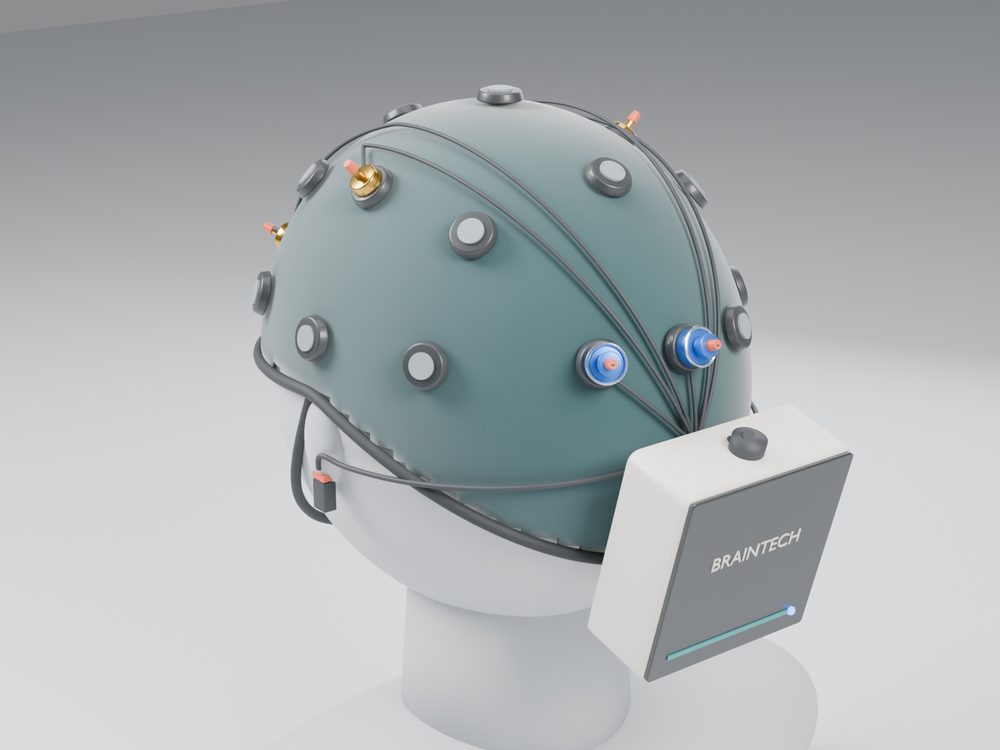
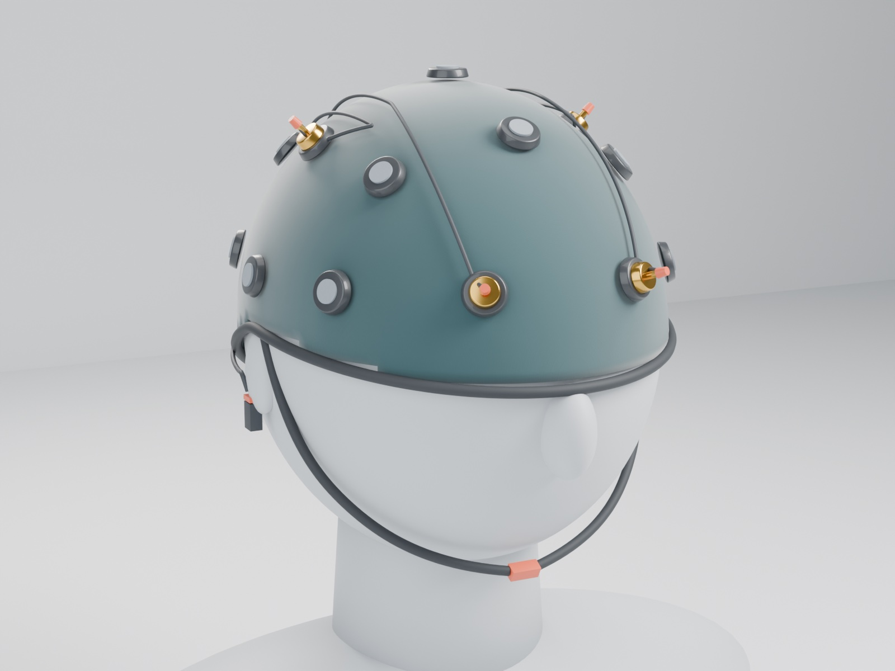
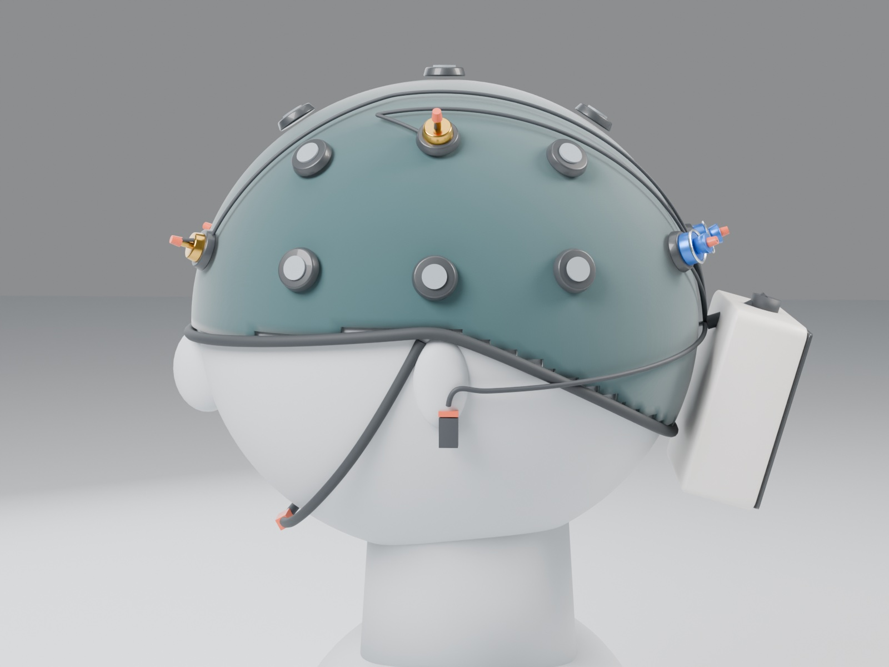

# EEG cap product concept

Blender model of a wearable version of the setup: a stretchy teal knit cap with electrode holders at the international 10-20 positions, dry comb electrodes (blue) at O1/Oz, gold cups at C3/C4/Fp1/Fp2, a braided wiring harness, SRB/BIAS ear clips, a chin strap, and a 75 × 75 × 30 mm case on the back for the OpenBCI Cyton and LiPo battery.

- `eeg_cap_concept.blend`: open in Blender 4.x / 5.x.
- `build_cap.py`: rebuilds the scene and renders the images: `blender -b -P design/build_cap.py -- --samples 128 --res 1600 1200`.

Concept for discussion, not a manufacturing drawing. Units: 1 Blender unit = 10 cm.
