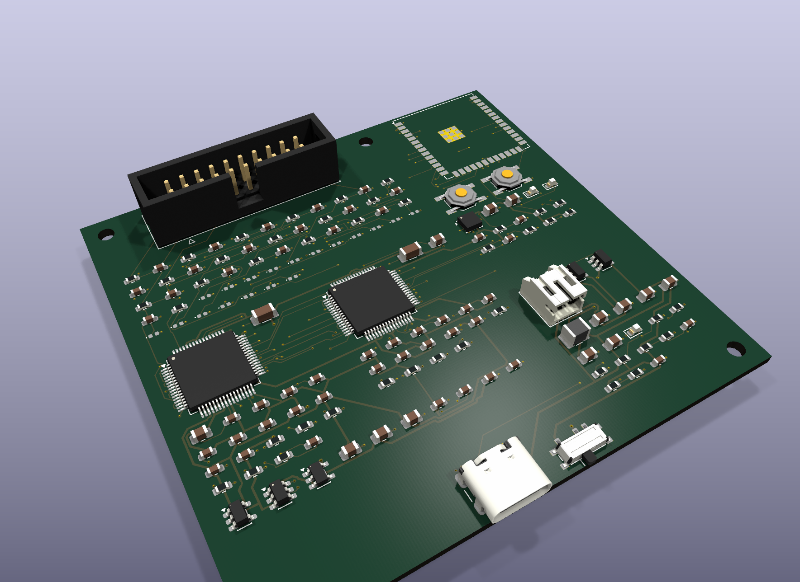
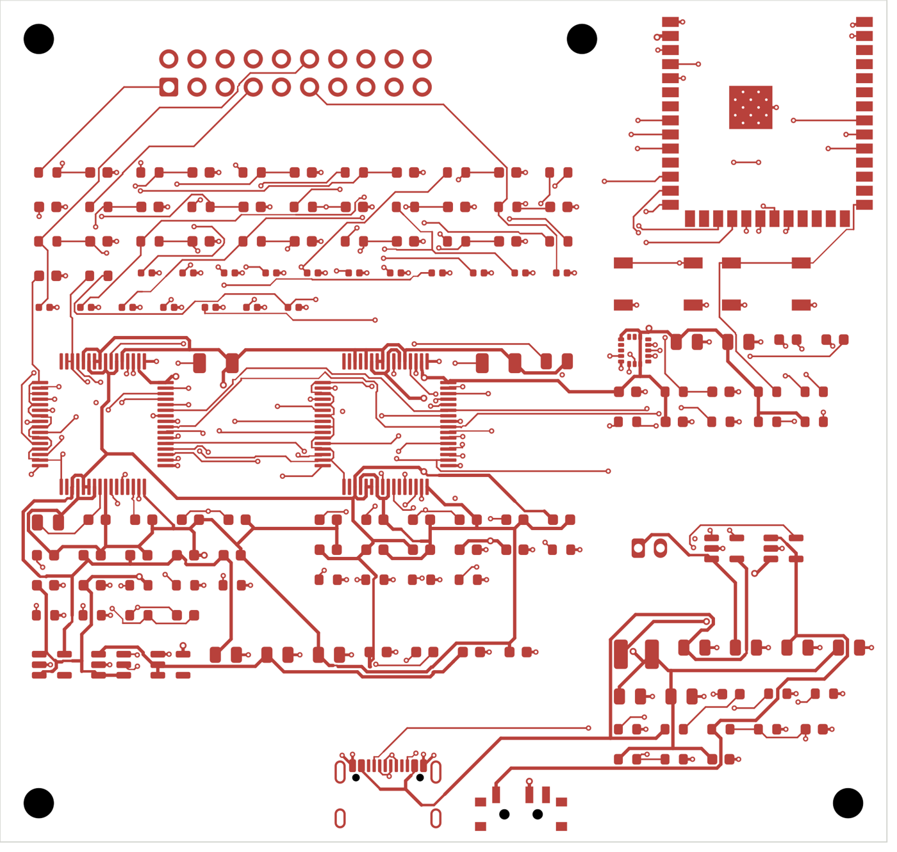
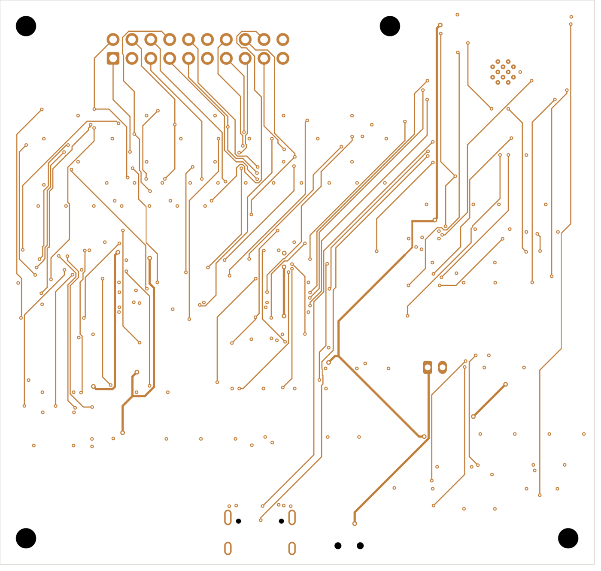
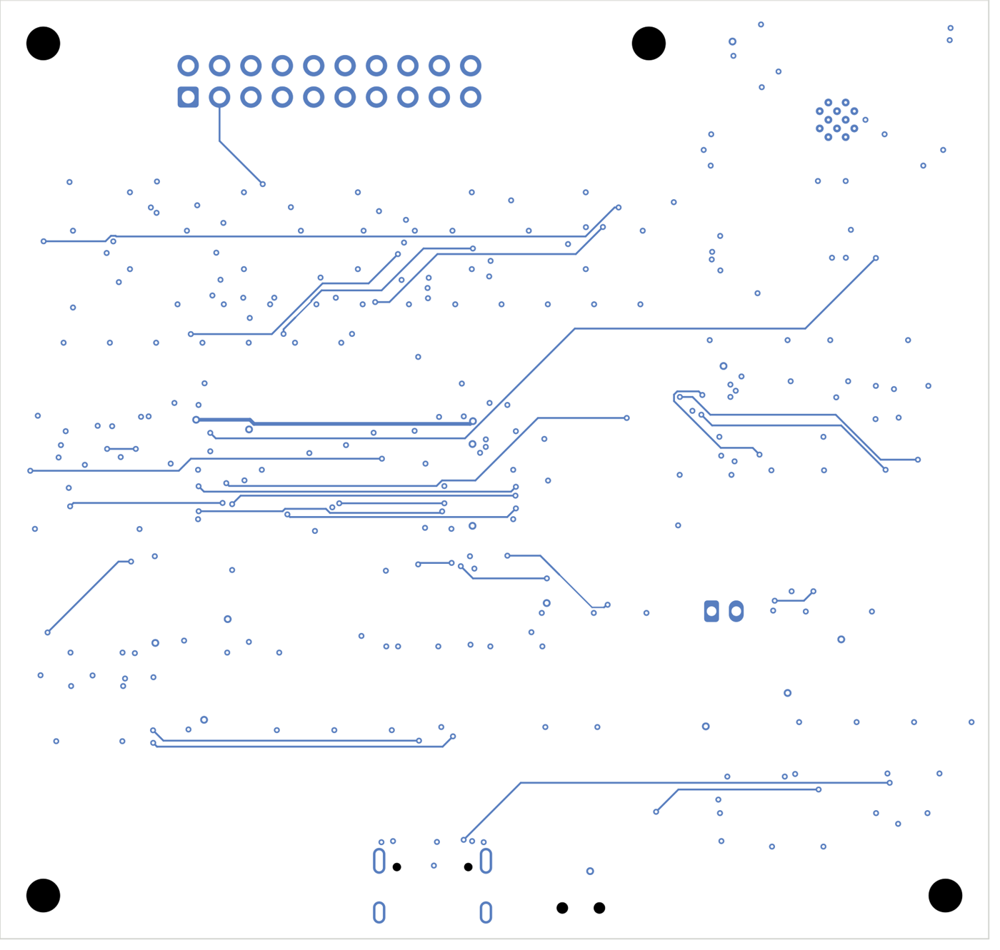

# BrainTech-16 design log (rev A)

How the 16-channel board was designed, step by step, and why each decision was made. Written so anyone can
redo or check every step. Dates are when the work was done.

**Goal:** a Cyton + Daisy equivalent (16 EEG channels, same ADS1299 front end, same data format) on **one
board** with a **built-in battery** and Wi-Fi, made by a normal PCB fab + assembly service, without buying a
Cyton or Daisy.

**Approach in one sentence:** copy what is proven (the Cyton's analog front end and TI's datasheet
recommendations), modernise what is obsolete (PIC32 + RFduino → ESP32-S3), and generate the design files
from a single Python description of the circuit so every value is reviewable as text.

> CS analogy: `circuit.py` is the "source code" of the board. The schematic, netlist, PCB and BOM are
> "build outputs" generated from it, the same way a compiler turns code into a binary. ERC and DRC are the
> "unit tests".

---

## Step 1. Collect the references (11 Oct 2026)

| Source | What we took from it |
|---|---|
| TI ADS1299 datasheet | pin table, required capacitor values, bias (driven right leg) circuit, daisy/multi-chip clocking, register map, layout guidance |
| OpenBCI Cyton schematic (V3 hardware files, CC BY-SA 3.0) | input protection network, supply topology (±2.5 V analog), how SRB/BIAS are wired, LIS3DH accelerometer |
| BrainFlow source code (`cyton_daisy_wifi`) | the exact Wi-Fi Shield protocol BrainFlow speaks, so our board can pretend to be a Cyton + Daisy + Wi-Fi Shield |
| OpenBCI Wi-Fi Shield firmware | HTTP endpoints and packet format (it also ran on an Espressif chip) |

The PDFs and schematic images are kept locally, not in the repo (copyright).

## Step 2. Fix the architecture

```
16 electrodes + SRB + BIAS → protection → 2 × ADS1299 (ch 1-8, ch 9-16) → SPI → ESP32-S3 → Wi-Fi → BrainFlow / OpenBCI GUI
                                        ↑ ±2.5 V quiet analog rails      ↑ 3.3 V
USB-C → LiPo charger → 1S LiPo → switch → 3.3 V buck → +2.5 V LDO, −3.3 V charge pump → −2.5 V LDO
```

Decisions and reasons:

1. **Two ADS1299 on one SPI bus with two chip-selects** (instead of the ADS1299's own daisy-chain mode).
   This is what OpenBCI does between Cyton and Daisy, and it lets the firmware read each chip
   independently. Chip 1 runs its internal 2.048 MHz oscillator and outputs it on CLK (CLK_EN = 1);
   chip 2 takes that clock (CLKSEL = 0), so both chips sample at exactly the same instant.
2. **ESP32-S3** instead of PIC32 + RFduino: one chip does SPI, Wi-Fi, Bluetooth LE and native USB.
3. **Same data format as Cyton + Daisy over Wi-Fi.** BrainFlow `CYTON_DAISY_WIFI`, the OpenBCI GUI and every
   analysis script in this repo work without changes. This was the most important software decision.
4. **Battery-only while worn** (USB is for charging and programming). This is a safety rule: the head must
   never be connected to mains-powered equipment.

## Step 3. Confirm every analog value against the datasheet and the Cyton

Each value below was read from the datasheet pin table / figures and cross-checked on the Cyton schematic.

| Pin / function | Value | Source |
|---|---|---|
| VREFP to VREFN | 10 µF ∥ 0.1 µF | datasheet pin table; Cyton |
| VCAP1 | 100 µF to AVSS | datasheet; Cyton |
| VCAP2 | 1 µF | datasheet; Cyton |
| VCAP3 | 1 µF ∥ 0.1 µF | datasheet; Cyton |
| VCAP4 | 1 µF | datasheet; Cyton |
| Every supply pin | 0.1 µF (+ 1 µF bulk per rail per chip) | datasheet layout section |
| Bias amplifier feedback | 1 MΩ ∥ 1.5 nF between BIASINV and BIASOUT | datasheet Fig. 68 |
| BIASREF | AVSS-referenced internal mid-supply (CONFIG3) → pin tied to AVSS | datasheet |
| Second chip's bias amp | powered down; BIASIN and BIASREF to AVSS | datasheet 10.1.1 |
| Electrode input | bidirectional TVS → 2.2 kΩ series → 1 nF to GND at the pin | Cyton topology. **Correction:** Cyton's TVS is the TPD4E1B06 (0.7 pF, 0.5 nA) and its caps are X7R ±20 %; rev A uses PESD5V0S1BL (35 pF, 5–100 nA). See *Proposed rev-A changes*. |
| CLKSEL | through 10 kΩ (chip 1 high, chip 2 low) | datasheet |
| DAISY_IN, RESV1 | to DGND | datasheet |
| GPIO1-4 | 10 kΩ to DGND (no floating inputs) | datasheet |

**Reference montage decision.** The Cyton routes the reference electrode to SRB2, which connects to the
**positive** inputs, and uses the electrodes on the negative side. That works but is confusing (it inverts
the sign unless firmware compensates). TI's datasheet recommends the opposite for a common reference:
electrodes on **INxP**, the reference on **SRB1**, which internally connects to every **INxN**
(MISC1 = 0x20, CHnSET = 0x60). We used TI's way. Every channel = electrode − reference, no sign tricks.

## Step 4. Choose the power parts

| Rail | Cyton uses | We use | Why |
|---|---|---|---|
| Charging | none (AA batteries) | **MCP73831**, 2 kΩ PROG = 500 mA, charge LED | built-in LiPo, one tiny SOT-23 part |
| USB-C | none | USB-C receptacle, 5.1 kΩ on CC1/CC2 | needed so USB-C chargers turn on 5 V |
| 3.3 V | regulator from batteries | **TLV62569** buck, 100 kΩ / 22.1 kΩ feedback = 3.31 V | ESP32 Wi-Fi peaks ~400 mA; a buck wastes less battery than an LDO |
| +2.5 V (AVDD) | TLV70025 | **LP5907-2.5** from 3.3 V | 6.5 µV RMS noise, very common |
| −2.5 V (AVSS) | LM2664 inverter + TPS72325 | **LM2776** inverter (→ −3.3 V) + **ADP7182-2.5** | same topology, newer parts in stock |
| Battery sense | – | 100 kΩ / 100 kΩ divider + 100 nF → ESP32 ADC | battery % for the status LED and auto-off |

The noisy parts (buck, charge pump) are placed far from the electrode inputs (step 7).

## Step 5. Write the circuit as code (`kicad/circuit.py`)

Every part is one Python dict: reference, KiCad symbol, footprint, value, MPN and a map
`pin → net`. Helper functions add repeated blocks (16 identical input-protection networks, decoupling
caps). Blocks: Power, MCU, ADS1299 #1, ADS1299 #2, Electrode inputs + protection, Mechanical.

ESP32-S3 pin map (chosen to avoid strapping pins and the pins used by the module's flash):

| Signal | GPIO | Signal | GPIO |
|---|---|---|---|
| SCLK | IO12 | DRDY1 | IO14 |
| MOSI | IO11 | DRDY2 | IO8 |
| MISO | IO13 | START | IO15 |
| CS1 | IO10 | ADS_RESET | IO16 |
| CS2 | IO9 | ADS_PWDN | IO17 |
| VBAT_SENSE | IO1 (ADC) | LED green / blue | IO4 / IO5 |
| I²C SDA / SCL (LIS3DH) | IO38 / IO39 | ACC_INT | IO40 |
| USB D− / D+ | IO19 / IO20 (native USB) | EN / BOOT | RC reset + buttons |

`kicad/kicad_lib.py` reads KiCad's own symbol libraries (S-expressions) so pin numbers and names always
match the real symbols.

## Step 6. Generate the schematic and run ERC (`kicad/gen_schematic.py`)

- Places every symbol on an A1 sheet in six labelled blocks and puts a **net label on every pin end**, a
  no-connect flag on every unused pin. No hand-drawn wires, so the schematic is exactly circuit.py.
- Output: `braintech16.kicad_sch`, `braintech16_schematic.pdf`, `braintech16.net`, `braintech16_bom.csv`.
- **ERC** (`kicad-cli sch erc`) found real problems, which were fixed in circuit.py:
  1. VBAT had two power outputs (battery + a power flag) → removed the extra flag.
  2. LIS3DH SDO (an output) tied straight to GND → now through 10 kΩ (sets the I²C address, can't short).
  3. Several pins floating → given explicit nets or no-connects.
- **Remaining: 1 message, a false positive.** Chip 2's CLK pin is an *input* fed by chip 1's CLK pin, which
  KiCad's symbol models as an input too (it is bidirectional in reality: an output when CLK_EN = 1).
  Documented in `erc.rpt`; safe to ignore.

## Step 7. Generate the PCB and place parts (`kicad/gen_pcb.py`)

Board: **80 × 76 mm, 4 layers** (top signals / In1 solid GND / In2 power / bottom signals), M2.5 holes in
the corners. Placement by zones, like districts on a map:

```
 ┌──────────────────────────────── 80 mm ───────────────────────────────┐
 │ hole   [ 20-pin electrode connector ]  hole │   ESP32-S3-WROOM-1U    │
 │ [ 18 × input protection: TVS, 2.2 k, 1 nF ] │   (u.FL antenna)       │
 │ ┌── ADS1299 #1 ───┐ ┌── ADS1299 #2 ───┐     │ LIS3DH, LEDs, buttons  │
 │ │ ch 1-8 + caps   │ │ ch 9-16 + caps  │     ├────────────────────────┤
 │ └─────────────────┘ └─────────────────┘     │ digital power: buck,   │
 │ [ analog power: LP5907, LM2776, ADP7182 ]   │ charger, battery JST   │
 │ hole                  [USB-C] [switch]                           hole │
 └──────────────────────────────────────────────────────────────────────┘
```

Analog on the left, digital and switching supplies on the right, inputs as far from the ESP32 and buck as
the board allows.

Problems found and fixed while iterating:

| Problem | Fix |
|---|---|
| KiCad's Python crashed (wx assert) | create a `wx.App` before using pcbnew |
| Crash (segfault) when filling the ground zone from Python | zone fill done by `kicad-cli pcb drc --refill-zones` instead |
| IDC connector placed vertically, wasting space | rotated 90° along the top edge |
| Zones overflowed | board enlarged from 60 × 60 to 80 × 76 mm; parts packed tallest-first |
| Router could not finish (step 8) | zones re-balanced (analog power under both ADS1299s, digital power below the MCU) and 1.2 mm space around each part (1.6 mm in the protection rows) |
| USB-C and power switch not reachable from outside the case | pinned to the bottom edge |
| Mounting holes inside part courtyards | moved to free corners |
| DRC: 0.15 mm pad gaps on the LIS3DH, USB-C hole clearance | rules set to normal 4-layer fab capability (0.15 mm clearance, 0.2 mm drill) |
| ESP32-S3-WROOM-1 antenna needs a 48 × 21 mm copper-free area | switched to **WROOM-1U** (u.FL connector, small stick-on antenna in the case) |

Result: 149 footprints, 98 nets, **0 DRC violations** before routing (only "unconnected" items, which
routing fixes). 38 pads are intentionally unconnected (unused module pins, etc.).

## Step 8. Routing (six attempts, each fixing what the previous one taught)

Tool: **Freerouting 2.5** (open-source autorouter). KiCad exports the board as a Specctra `.dsn` file, Freerouting
returns a `.ses` file with the tracks, and `import_ses.py` puts them back into the KiCad board.

| Attempt | Setup | Result | What we learned |
|---|---|---|---|
| 1 | GND in the 0.4 mm "Power" class, 0.6 mm vias everywhere | **31 connections left unrouted** after 14 passes | The ADS1299 pins are 0.5 mm apart. A 0.4 mm GND track or a 0.6 mm via cannot get out between them, so the chip's ground pins never reached the plane. |
| 2 | GND not routed as tracks (only vias to the plane); signal tracks 0.15 mm, vias 0.45/0.2 mm; power rails 0.3 mm | **Fully routed, 0 violations in 4 passes** (85 s) | Right-sizing the rules for the parts matters more than CPU time. |
| 2b | DRC on that result | 1,362 "errors" | Not real: `gen_schematic.py` had overwritten `braintech16.kicad_pro`, which is where KiCad keeps the design rules, so DRC used KiCad's defaults (0.2 mm track, 0.3 mm drill). Fixed: the generator never overwrites the project file, and `set_rules.py` writes the fab rules + net classes into it. Then 0 copper errors. |
| 3 | Same, checked layer by layer | 237 track segments on **In1.Cu** | KiCad exported In1 as a *signal* layer, so the router used our ground plane for wiring (3V3, electrode lines …). That cuts the plane into pieces, which costs noise on an EEG board. Fixed: In1 is now declared a *power plane* layer, so the router cannot use it. Re-routed from placement. |
| 4 | In1 = solid GND plane (no tracks); routing on F.Cu, In2.Cu, B.Cu | 74 unrouted | With one layer fewer, the router could no longer get ground pins to the plane. |
| 5 | More space between parts, zones re-balanced | 77 unrouted (no better) | Density was not the problem: 33 of the failures were GND pads. |
| 6 | **`gnd_vias.py` first:** every SMD ground pad gets its own short stub + via to the plane *before* routing (locked, 104 vias), fine-pitch ICs first so passives do not take their spots | **0 unrouted** after 6 passes, then 3.5 min of optimisation | This is how a human would do it: ground is a plane, not a net to route. The router then only routes signals. |

Small follow-ups:
- `gnd_vias.py` searches 24 directions × 14 distances around each ground pad for a via spot ≥ 0.2 mm (else
  the board minimum 0.15 mm) from everything else. Two bugs fixed on the way: pads were compared by Python
  object identity (KiCad returns a new wrapper each time, so a pad blocked itself) and passives were
  processed before the LIS3DH, taking the only free spots next to its 0.5 mm-pitch ground pads.
- The router necked two short pieces of track down to 0.09 mm next to fine-pitch pins; `import_ses.py`
  widens anything below 0.1 mm back to 0.1 mm (DRC confirms clearances still hold).
- Saving a newly created board resets KiCad's project rules, so `build.sh` re-applies `set_rules.py` after
  placement and before DRC.
- GND plane fill: 0.2 mm clearance (instead of KiCad's default 0.5 mm) so it stays continuous between dense via
  rows; solid connection to pads; isolated islands removed.
- Reference designators hidden on the silkscreen. The board is machine-assembled, so refs stay on the
  assembly (F.Fab) layer and in the pick-and-place file. This removed 263 cosmetic silkscreen warnings.

**Important:** an autorouter does not know EEG rules: it does not keep electrode traces short and
equal, or keep SPI and the charge pump away from the inputs. The routed board is electrically complete and passes DRC,
but **the analog section must be reviewed (and partly re-routed by hand) by someone experienced before ordering.**

## Step 9. Firmware (`firmware/eeg16_esp32/`)

Written for the ESP32-S3 (Arduino core 3.x), compiled with `arduino-cli` (fqbn `esp32:esp32:esp32s3`):
**929 KB, 70 % of flash. Compiles without errors.** Not yet run on hardware (there is none yet).

What it does:
- Configures both ADS1299s: CONFIG1 0xB0|rate on chip 1 (clock out) and 0x90|rate on chip 2;
  CONFIG2 0xC0; CONFIG3 0xEC on chip 1 (internal reference, bias on) / 0xE0 on chip 2;
  CHnSET 0x60 (gain 24, normal input); MISC1 0x20 (SRB1); BIAS_SENSP/N on chip 1 only.
- On each DRDY reads both chips and sends **two 33-byte Cyton packets with the same sample number**
  (channels 1–8, then 9–16). This is exactly what BrainFlow expects for Cyton + Daisy.
  (First version used separate counters → BrainFlow would have dropped data. Found by reading BrainFlow's
  source; fixed.)
- Emulates the OpenBCI **Wi-Fi Shield** HTTP API: `GET /board`, `POST /tcp` (BrainFlow tells the board
  where to connect), `POST /command`, `GET /stream/start`, `GET /stream/stop`, plus `GET /battery`.
- Accepts Cyton text commands: `b` `s` `d` `v`, test signals `-` `=` `[` `]`, sample rate `~4/5/6`,
  channel settings `x…X` (9 characters; first version mis-parsed 8 → fixed), channel on/off keys.
- USB serial fallback (same packets) for bench testing.
- Wi-Fi credentials in `secrets.h` (git-ignored); copy `secrets.example.h`.

How to use it on a computer:
```python
from brainflow.board_shim import BoardShim, BrainFlowInputParams, BoardIds
p = BrainFlowInputParams(); p.ip_address = "<board IP>"; p.ip_port = 6677
b = BoardShim(BoardIds.CYTON_DAISY_WIFI_BOARD, p)
```

## Step 10. Things still marked [verify] before ordering

1. **ADP7182 EN pin**: tied to VIN (enabled). Check the polarity in the exact datasheet revision.
2. **TVS part**: the PESD5V0S1BL in rev A is too leaky and too capacitive for dry electrodes; use the
   TPD4E1B06 like the Cyton (see *Proposed rev-A changes*, items 1 and 3).
3. **Footprints vs purchased parts**: USB-C receptacle, slide switch, inductor, JST-PH.
4. **Layout review by an experienced engineer.** Things I would check first:
   - **Decoupling distance:** the placer packs each ADS1299's capacitors in rows next to the chip, not
     at each supply pin. Move the 0.1 µF caps to within ~1 mm of their pins (VCAP/VREF caps too).
   - **Input traces:** the electrode lines from the connector to the protection network and then to
     the ADS1299 should be short and similar in length, away from SCLK/MOSI/DRDY and the charge pump.
   - **Ground:** one continuous plane on In1 (TI's recommendation for the ADS1299: no split, keep
     digital return currents away from the analog area by placement). Check that no slot cuts under the ADCs.
   - **Charge pump (LM2776) and buck (TLV62569):** short, tight loops for their capacitors and inductor.
   - **Antenna:** stick the u.FL antenna inside the case, away from the battery and the electrode harness.
5. **Bench bring-up order**: power rails (no ADS fitted or with PWDN low) → one ADS1299 (read ID register
   0x3E) → second ADS1299 → shorted-input noise → internal test signal → Wi-Fi streaming → full
   validation battery (same tests as the Cyton in this repo).

## Proposed rev-A changes from electrode research (pending user approval)

Source: the separate electrode/wiring research session (report on the user's Mac:
`BrainTech/reports/EEG electrodes and wiring.md`), checked against `circuit.py` at commit `3258edc`.
**Nothing below is applied yet.** No re-placement or re-routing until the user decides.

| # | Proposal | Why |
|---|---|---|
| 1 | Input shunt caps: **47 pF C0G ±2 %** on CH1–16 and identically on SRB (instead of 1 nF), footprint kept, DNP-able | With high, mismatched dry-contact impedance (0.5–2 MΩ) a 1 nF cap to GND turns mains common-mode into a differential signal: only about −12 to −17 dB rejection, vs −37 to −51 dB with 47 pF. The ADS1299 delta-sigma input does not need a large anti-alias cap. All values are fine with gel. |
| 2 | BIAS series resistance **≥ 100 kΩ total**, as two footprints: RP1 outside and RP2 inside the bias loop (now 2.2 kΩ only) | BIASOUT can source about 1.1 mA (datasheet: short-circuit 1.1 mA). TI SBAA188 recommends ≤ 50 µA single-fault body current. |
| 3 | TVS: low-leakage, low-capacitance part (**TI TPD4E1B06**, what the Cyton actually uses), DNP-able | Dry contacts are 0.3–1 MΩ, so the TVS leakage and capacitance must be tiny: ≤ 0.5 nA and < 1 pF. |
| 4 | Connector **2×13** keyed shrouded IDC: 1 SHIELD_DRV, 2–9 IN1–IN8, 10 SRB, 11 GND, 12 BIAS, 13 GND, 14–21 IN9–IN16, 22 GND, 23 IMP_EXC, 24 +2.5V_AE, 25 −2.5V_AE, 26 spare (0 Ω/DNP to GND or SHIELD_DRV). Fallback: keep the 2×10, add a keyed 1×5 aux header with the five extra nets | Spare pins for future active electrodes |
| 5 | ±2.5V_AE electrode supplies from AVDD/AVSS: ferrite + 10 Ω + 10 µF/100 nF at the connector, DNP 0 Ω links so a passive harness carries no supply | ~13–16 mA per rail for 17 OPA376 buffers |
| 6 | Shield driver (DNP): OPA2376 on AVDD/AVSS, input by 0 Ω links (BIAS common-mode / buffered SRB / GND), output via 100 Ω–1 kΩ to SHIELD_DRV; second half as an optional SRB buffer with 0 Ω bypass | Do not drive the shield from BIASOUT (specified into 50 kΩ ∥ 10 pF only) |
| 7 | IMP_EXC: ESP32-S3 GPIO (LEDC PWM) → RC low-pass → DNP series R → connector | Impedance checks with active electrodes (ADS1299 lead-off cannot see the skin through a buffer) |
| 8 | Guard pour around the 17 input traces, jumper-selectable SHIELD_DRV or GND; matched lengths; away from charge pump, charger, antenna | Lower pickup and leakage on the high-impedance inputs |
| 9 | Nice to have: VBUS detect → GPIO, firmware stops streaming and disables BIAS while USB is plugged in | Safety: enforces "never worn while connected to a charger/PC" in firmware |

### Answers to the research session's questions

**Q1. What dielectric/tolerance is the 1 nF input cap?**
**Unspecified.** `circuit.py` has only `C("1nF", ...)`, generic 0603 footprint, no MPN. My
purchasing `BOM.csv` says "1 nF C0G", so the two files disagree. That needs fixing whichever value is chosen.
For reference, the Cyton schematic uses a **CKCL44X7R1H102M** 4-cap array, which is **X7R, ±20 %**, 1 nF:
the worst case for channel-to-channel matching. The series 2.2 kΩ is also unspecified in `circuit.py`.
The Cyton uses a CAY16 2.2 kΩ ±1 % array. If item 1 is accepted, specify the resistors as ±1 % too, since
mismatch in R or C both degrade common-mode rejection.

**Q2. PESD5V0S1BL leakage and capacitance?** (Nexperia datasheet Rev. 04, Table 9, per diode, 25 °C)
- Leakage I_RM: **5 nA typ, 100 nA max** at V_RWM = 5 V (no value specified near 0 V).
- Capacitance C_d: **35 pF typ, 45 pF max** at V_R = 0 V, 1 MHz.

So it fails both research targets: 10–200× the 0.5 nA leakage and ~40× the 1 pF capacitance.
**This was my mistake in rev A:** I labelled the input network "as Cyton", but the Cyton actually uses the
**TPD4E1B06** quad TVS (TI: 0.7 pF typ, 0.5 nA max, 5.5 V, SOT-5X3 1.6 × 1.6 mm or SC70-6).
**Important coupling between items 1 and 3:** the PESD's 35–45 pF to ground (with part-to-part spread) sits on
the same input as the shunt cap. Changing the 1 nF to 47 pF while keeping the PESD would leave most
of the common-mode-to-differential conversion in place. Items 1 and 3 should be done together.

**Q3. LM2776 output current rating, and headroom for item 5?** (TI datasheet SNVSA56B)
- LM2776: **200 mA** recommended max output (250 mA abs. max continuous), R_OUT 2.5 Ω typ, current limit 400 mA.
- ADP7182: 200 mA rated. LP5907 (AVDD): 250 mA.
- Load today: 2 × ADS1299 at **7.14 mA** I_AVDD each (datasheet, bias off) ≈ 14 mA per rail, + bias amp.
- With 17 OPA376 buffers (≈ 0.76 mA typ / 0.95 mA max each ≈ 13–16 mA) + optional OPA2376 (~2 mA): **≈ 32 mA per rail**,
  i.e. ~15 % of the rating. No problem.
- Headroom for the negative LDO: −3.3 V + 32 mA × 2.5 Ω ≈ −3.22 V into the ADP7182 for −2.5 V out. That leaves ~0.7 V,
  far above its dropout at this current. OK.
- **One thing to check on the bench (any option):** at light load the LM2776 runs in PFM mode, with ~80–110 mV output ripple
  between ~1 and ~50 mA (datasheet Fig. 1, V_IN = 5.5 V). The ADP7182 and the ADS1299's PSRR should remove
  it, but measure AVSS ripple and look for spurs in the shorted-input noise test. A ~30 mA load moves it towards
  the upper edge of that range.

**Q4. Rough area and routing effort on the current 80 × 76 mm layout**

Free space inside the current placement zones (from `gen_pcb.py`'s zone report): analog-power strip ~300 mm²,
MCU column ~160 mm², digital-power column ~135 mm², total **~600 mm²**.

| # | Extra parts (approx.) | Area | Routing impact |
|---|---|---|---|
| 1 | none (value/part change, same 0603 footprint) | 0 | none, BOM only |
| 2 | +1 resistor (0603) | ~7 mm² | local, 1 net split |
| 3 | 18 × 0402 TVS → 5 × TPD4E1B06 (DRL 1.6 × 1.6 mm) | ~ −25 mm² (smaller) | re-route the protection area |
| 4 | 2×13 IDC is ~7.6 mm longer (~41 vs ~33 mm). It fits the 41 mm connector zone only just, so the zone extends towards the ESP32 column | ~+60 mm² | **new pinout: re-route the whole analog input section** |
| 4-alt | keep 2×10 + 1×5 aux header (~13 × 5 mm) | ~+65 mm² | only 5 new nets |
| 5 | 2 × (ferrite, 10 Ω, 10 µF, 100 nF, 0 Ω DNP) = 10 parts | ~75 mm² | local, near the connector |
| 6 | OPA2376 (VSSOP-8) + 2 decoupling + ~6 0 Ω/R | ~90 mm² | local, 4–5 nets |
| 7 | R + C + DNP R; GPIO IO6 (LEDC) | ~20 mm² | **one ~45 mm trace from the MCU to the connector**: route on In2/B.Cu away from the inputs |
| 8 | solder jumper (3-pad) + pours | ~10 mm² | **manual work:** an autorouter cannot do guard pours or length matching |
| 9 | 2 resistors (VBUS 100 k / 150 k divider → 3.0 V) to GPIO IO7 | ~14 mm² | local |

**Total ≈ 30 new parts, ~250–300 mm²: fits on 80 × 76 mm** (≈ half of the free space). Free ESP32-S3 GPIOs
(not strapping, not used): IO2, IO6, IO7, IO18, IO21, IO41, IO42, IO47, IO48.

**Effort:**
- Items 1, 2, 5, 6, 7 and 9 are `circuit.py` edits plus one `build.sh --pcb` run (~5 min each time).
- Items 3 and 4 also go through the scripted flow, but they change the whole input section, so its earlier review would have to be redone.
- Item 8 (guard pour, matched lengths) is **hand layout in KiCad, roughly 0.5–1 day**, and is best done in the same pass as
  the planned human review (decoupling caps at the ADS1299 pins, input traces).
- Suggested order if all are approved: 1+3 together → 2 → 4 (or 4-alt) → 5, 6, 7, 9 → re-place/re-route → 8 by hand → review.

## How to regenerate everything

```bash
cd hardware/kicad
./build.sh          # schematic, ERC, BOM, netlist, DRC, Gerbers, drill, pick-and-place, STEP, pictures
./build.sh --pcb    # ALSO re-place and re-route from scratch (about 5 minutes)
```

`build.sh` runs, in order: `gen_schematic.py` → `set_rules.py` → kicad-cli ERC/PDF/netlist/BOM →
[`gen_pcb.py` → `set_rules.py` → `gnd_vias.py` → `route_prep.py` → Freerouting → `import_ses.py`] →
kicad-cli DRC (with zone fill) → fab outputs → renders.

Tools: KiCad 10.0.4, Freerouting 2.5.0 (Java), arduino-cli with esp32 core 3.3.11.

## Routing result (final, rev A)

| Check | Result |
|---|---|
| Connections routed | **all** (0 unrouted) |
| KiCad DRC, copper (clearance, width, drill, annular ring, edge) | **0 errors** |
| Remaining DRC items | 2 silkscreen warnings: the power switch deliberately overhangs the board edge so it can be reached through the case |
| ERC | 1 known false positive (ADS1299 CLK pin, see step 6) |
| Ground plane (In1.Cu) | solid, no tracks |
| Vias | 297 (104 of them dedicated ground vias), 0.45 mm / 0.2 mm drill; power 0.6 / 0.3 mm |
| Tracks | 1,747 segments, 4.2 m total: F.Cu 1,228, In2.Cu 417, B.Cu 102; min width 0.1 mm, signals 0.15 mm, power 0.3 mm |
| Fab rules used | 0.15 mm clearance, 0.1 mm min track, 0.2 mm min drill (standard 4-layer at JLCPCB/PCBWay) |

Fabrication files: `kicad/fab/braintech16_gerbers.zip` (Gerbers + drill), `braintech16_pos.csv`
(pick-and-place), `braintech16_bom.csv`, `braintech16.step` (3D model for the case design).



| Top copper | Inner 2 (signals) | Bottom copper |
|---|---|---|
|  |  |  |

**Before ordering**, step 10 still applies. The board is electrically complete and passes every automatic
check. An automatic check cannot judge EEG noise performance, so the analog area needs a human review.
