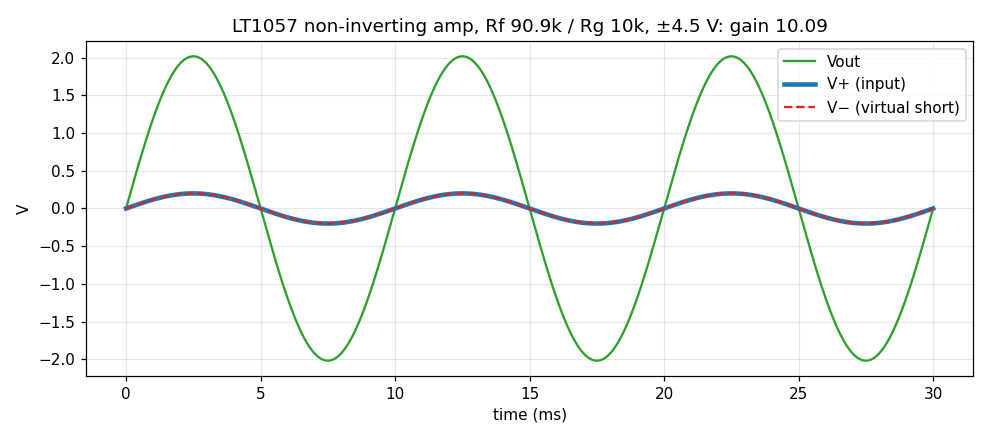
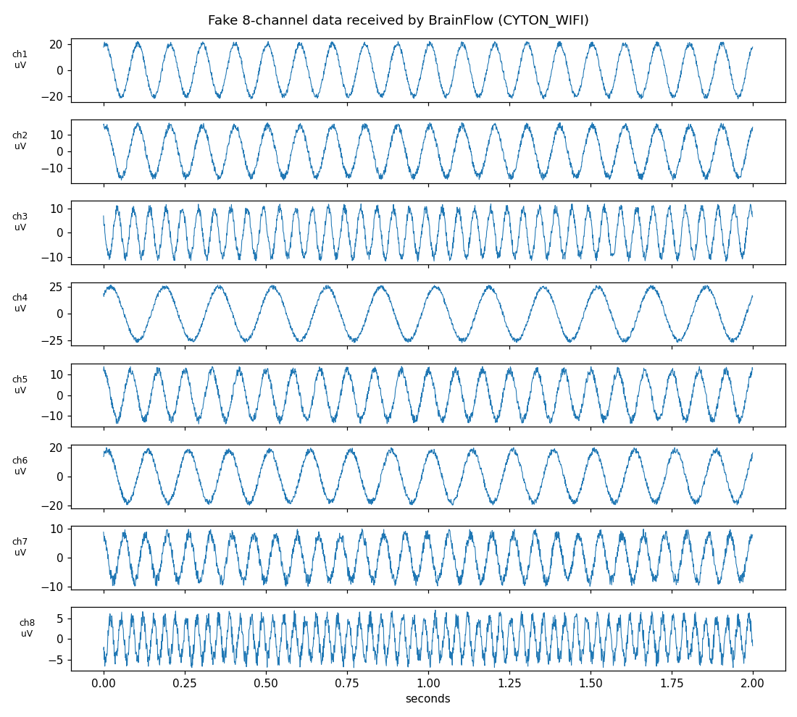
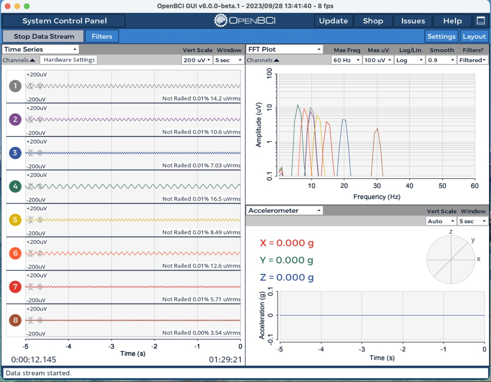

# Week 2 notes

## 3 Nov: LTspice non-inverting amplifier, gain 10

Files: `noninv_gain10.asc` (schematic), `noninv_gain10.net` (netlist), `noninv_gain10.png` (plot).

- Op amp: **LT1057** (JFET-input dual, the closest LTspice has to the TL072; there is no TL072 model in the library).
- Rf = 90.9 kΩ, Rg = 10 kΩ → gain = 1 + Rf/Rg = **10.09**.
- Supplies ±4.5 V (stand-in for the 9 V battery split in the middle).
- Input: SINE(0 0.2 100), 0.2 V peak at 100 Hz. `.tran 30m`.

| | Expected | Simulated |
|---|---|---|
| Vout peak | 2.018 V | **2.018 V** |
| Gain | 10.09 | **10.090** |
| V− vs V+ | equal (virtual short) | within **40 µV** |
| Phase | in phase (non-inverting) | in phase |

Lessons:
- Component picker opens in the last folder used (it was on Digital → "and"), so always search by name and check the preview.
- On this Mac the LTspice menu bar sits on the laptop screen, not the external monitor. Use the toolbar: `.t` = SPICE directive.
- Typing into LTspice via automation comes out as "aaaa"; type by hand.

Next: try amplitude 0.5 V to see clipping at the rails, then build it with the TL072 on the breadboard (Rf = 47k + 47k = 94k → gain 10.4).

## To do at home: TL072 gain-10 amplifier on the breadboard (9 V battery)

Parts: TL072, 9 V battery + snap, 2× 1 kΩ, 2× 100 µF electrolytic, 2× 0.1 µF ("104"), 10 kΩ, 2× 47 kΩ, 100 kΩ, 4.7 kΩ (and 22 kΩ for the clipping test).

1. **Split supply:** battery + → 1 kΩ → GND row → 1 kΩ → battery −. A 100 µF across each 1 kΩ (long leg toward the higher voltage). Check: red rail +4.5 V, blue rail −4.5 V (black probe on GND).
2. **TL072:** notch = pin 1. Pin 8 → +4.5 V, pin 4 → −4.5 V (double-check: swapped = dead chip). 0.1 µF from pin 8 to GND and from pin 4 to GND, close to the chip. Unused half: pin 5 → GND, pin 6 → pin 7.
3. **Amplifier:** +4.5 V → 100 kΩ → node → 4.7 kΩ → GND; node → pin 3 (Vin ≈ 0.20 V). Pin 2 → 10 kΩ → GND. Pin 2 → 47k + 47k → pin 1 (Rf = 94 kΩ, gain 10.4).
4. **Measure** (Ω first: Rf, Rg, 100k, 4.7k), then with power, black probe on GND:

| Point | Expected | Measured |
|---|---|---|
| + rail / − rail | +4.5 / −4.5 V | |
| Pin 3 (Vin) | ≈ 0.20 V | |
| Pin 2 (V−) | same as pin 3 | |
| Pin 1 (Vout) | ≈ 2.1 V | |
| Gain = pin 1 / pin 3 | ≈ 10.4 | |

5. **Clipping test:** swap 4.7 kΩ → 22 kΩ (Vin ≈ 0.81 V). Vout stops near +3 V; pins 2 and 3 no longer match.

Safety: battery only, nothing on the body. Chip hot → unplug (pins 4/8 swapped). Unplug the battery when done (the divider drains ~4.5 mA). If the TL072 misbehaves at ±4.5 V, try the LM358.

## 3–4 Nov: ESP32 blink, Wi-Fi and BrainFlow

**Blink** (`esp32_blink/`): the sketch runs, but this DevKit clone has **no LED on GPIO 2**. The blue LED near USB is the USB-serial (FT232R) data light: it flashes whenever `Serial.print` sends text. Still to do: prove GPIO 2 (right header pin 15) switches 3.3 V ↔ 0 V with the multimeter.

**Wi-Fi + fake 8 channels** (`esp32_wifi_fake8/`): UDP, 250 SPS, 10 samples per packet, text `sampleNum,ch1..ch8` in µV.

| Mode | Received | Lost |
|---|---|---|
| Broadcast to 192.168.1.255, −80 dBm | ~40 samples/s | **84%** |
| Broadcast, −70 dBm | ~210 samples/s | 15–17% |
| Unicast to the Mac 192.168.1.8 | ≈ 250 samples/s | ≈ 0% |

Lesson: broadcast Wi-Fi frames are never ACKed or retried and get buffered for sleeping clients (bursts every ~200 ms). Unicast gets ACK + retries. Per-second rates above 250 are late packets landing in the next 1-s window.

**BrainFlow** (`esp32_brainflow_fake8/`): the ESP32 emulates an OpenBCI Cyton + Wi-Fi Shield (`/board`, `/tcp`, `/command`, `/stream/start|stop`, 33-byte packets over TCP). BrainFlow `CYTON_WIFI_BOARD` sets 1000 Hz (`~4`).

10 s test: **10,020 samples (1002/s), 0 lost**. Every channel's frequency and amplitude matched (e.g. ch1 10.0 Hz / 20.1 µV, ch8 30.0 Hz / 5.3 µV).

**OpenBCI GUI** (v6.0.0-beta.1): CYTON (live) → Wifi (from Wifi Shield) → Static IP `192.168.1.12` → 8 channels, 1000 Hz → Start Session → Start Data Stream. All 8 traces move and the FFT shows peaks at 6, 8, 10, 12, 15, 20, 30 Hz. uVrms matches amplitude/√2 (ch1 14.2 ≈ 20/1.414).

## 4 Nov: LM358 gain-10 amplifier (USB 5 V)

No 9 V battery, so the TL072 was swapped for an **LM358** (same pinout, runs on a single 5 V supply) powered from the ESP32 DevKit's 5V pin (left pin 19) and GND.

- Pin 8 → 5 V, with a 0.1 µF (104) decoupling cap to GND; pin 4 → GND
- Pin 3 ← 100k/4.7k divider: Vin = 5 × 4.7/104.7 ≈ 0.22 V
- Pin 2 → Rg 10k to GND, Rf 94k (47k + 47k) to pin 1: gain = 1 + 94/10 = 10.4 → Vout ≈ 2.3 V
- Unused half: pin 5 → GND, pin 6 → pin 7

**Result: the output measured about 10× the input.** ✅ The op amp holds pin 2 equal to pin 3, and the Rf/Rg divider sets how high the output must go to make that true.

Note: the divider input comes from the same 5 V rail, so about 0.47 × any USB ripple shows up at the output (fine for a DC multimeter test).

Next: clipping test (4.7k → 22k gives Vin ≈ 0.86 V, ideal Vout ≈ 9 V, but the LM358 output stops near 3.5 V on 5 V, and pins 2 and 3 stop matching).
