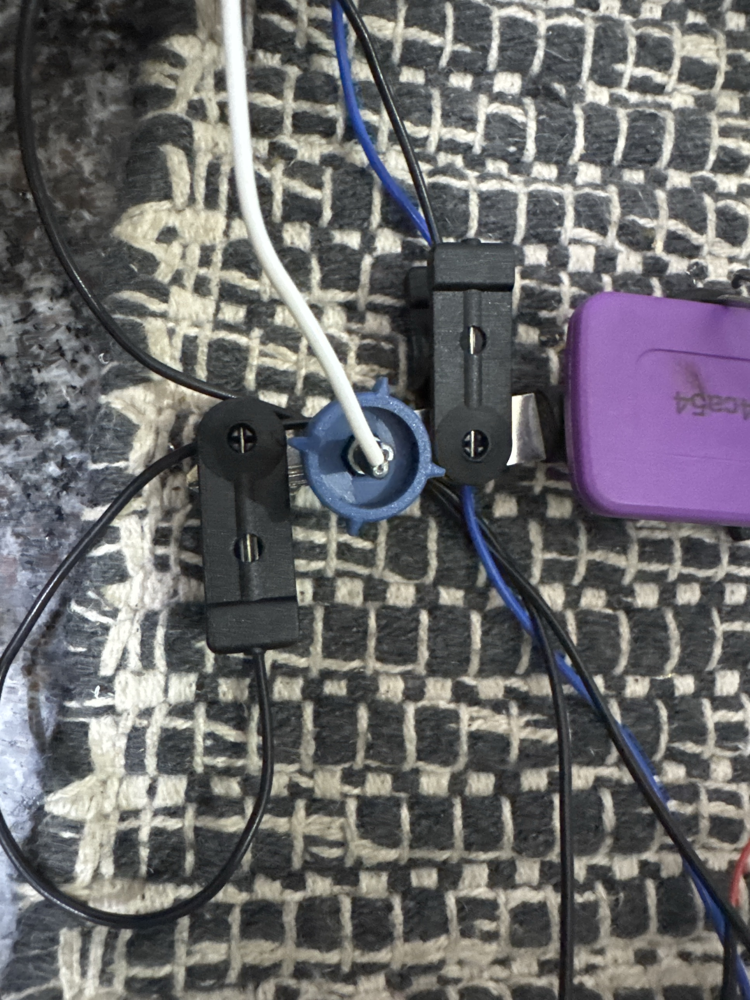
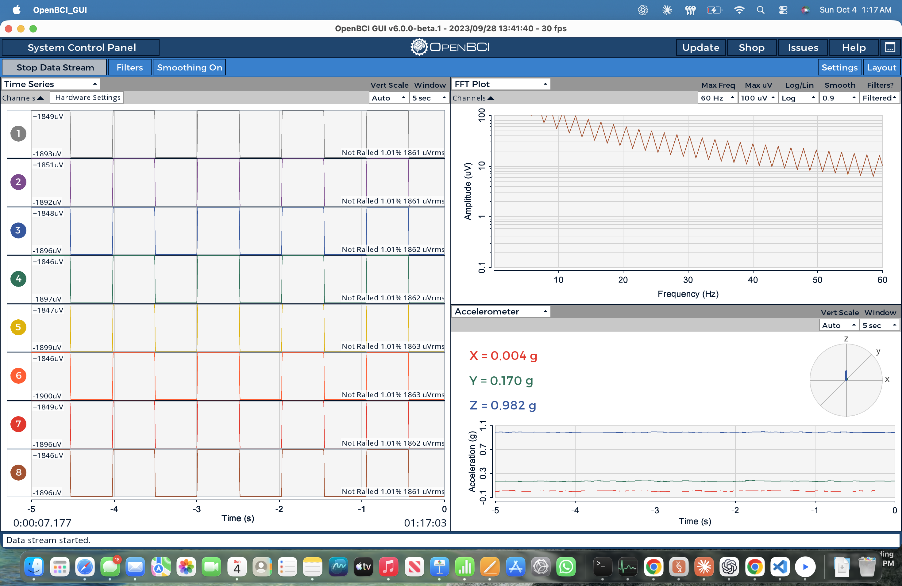

# BrainTech daily log

Short check-ins: what we did, what we learned, what's next. Newest first.

## 2026-10-04 (afternoon)
- Step 2 round 1, dry electrode ECG (13:21): FAIL. 75.8 % beats clean, SNR 5.2 (weak dry contact); ECG shape correct (QRS 80 ms, T 212 ms). Oximeter readings still to add.
- Upgraded live heart-rate dashboard (`live_hr.py`): 8-s average to compare with the oximeter, signal-quality label, per-second CSV log.
- Found the heart rate jumping 80↔160 bpm: the detector was counting the T wave as a second beat (half-length RR intervals). Added `merge_double_detections` to the beat detector → 80 bpm steady, 97 % clean on the same data.
- Dry electrode contact kept drifting toward the limit, then lost contact at 14:00:40.
- After re-seating the dry electrode (14:03), 10 min of clean ECG: 810 beats, 100 % clean, 80.6 bpm (66–105), SNR 46.9, QRS 68 ms, T at 236 ms; dashboard and raw-signal heart rate agree within ~1 bpm per minute.

- Notes now carry charts, screenshots and photos. Apple Notes won't display images added by automation (tried inline HTML, attachments and import), so Notes links to each image on GitHub, where the same log renders them inline.
- Published all BrainTech work to the public GitHub repo (`braintech-eeg-classification`): README section on the Cyton hardware work, the validation tracker and daily log with images, all live_inference tools.
- **Next:** rerun the formal dry-electrode ECG test with oximeter readings; then gold electrode.

## 2026-10-04 (early hours)
- Got the internal test signal visible in the GUI: Expert Mode custom command `-`, bandpass off (All circle), notch None, scale Auto → clean ±1,875 µV square wave on all 8 channels.
- Validated it from the GUI recording too (±1,870 µV, 1.024 s, ch1–ch2 gain match 0.018 %).
- Board battery ran flat mid-session (packet loss → disconnect); swapped battery, link clean again (0 dropped).
- Set up screen capture + guarded clicking so Claude can drive the GUI (check front app before every click, verify via screenshot and board log).
- Notes now live in Apple Notes › BrainTech (synced from notes/*.md); tracker rewritten with plain-language explanations of every test.
- Same-spot fingertip test: hum ~1.5 µV, but 10–40 µV slow drift from the dry electrode's skin contact; metal-to-metal external short still to do.
- External short PASSED using a metal key as the shared metal: 0.13 µV noise, 0.14 µV hum, offset −26 µV (same as internal short) → wires/clips/pins add nothing. Confirmed hands-free 02:27:53–02:28:12 (0.12 µV noise, 0.10 µV hum, offset −25 µV). Lesson: dry comb pins need pressure for solid contact. **Step 1 complete.**

- **Next:** Step 2 ECG + pulse oximeter.

## 2026-10-03
- Planned the formal validation (3 steps: board → independent device → cause/effect physiology); built `validate_board.py` and `test_signal_check.py`.
- Step 1 passed: integrity, shorted inputs (0.10 µV noise), internal test signal on all 8 channels.
- Learned the GUI quirks (Send + restart stream; "Test" mode doesn't drive the generator).
- Built `eeg_compare.py` + electrode placement diagram for dry vs gold EEG (forehead Fp1/Fp2 option since no paste).

## 2026-10-02
- ECG from wrists: clear heartbeat once electrode and SRB were on opposite wrists (80 bpm).
- Built `heart_monitor.py`, `live_hr.py` (live window), `breathing_hr.py` (guided breathing protocol), `compare_electrodes.py`.
- Breathing run: paced breathing swings heart rate ~28 bpm; breath-holds give a brief dip.
- Dry vs gold ECG: dry cleaner without paste (SNR 42.6 vs 18.8).

## 2026-10-01
- First look at live Cyton data: floating inputs, railing, 50 Hz pickup from long leads, notch/bandpass effects.
- Built `gui_monitor.py` / `noise_breakdown.py` (LSL) for live filter + noise analysis.

## 2026-10-04 (evening)

- The dry comb electrode is broken, so it is on hold until it is repaired. All remaining tests (ECG vs oximeter, blinks, jaw, alpha, SSVEP) will use the **gold cup electrode** first.
- Correction: the 13:55-14:13 ECG session was recorded with the **gold electrode** (on the channel 1 lead), not the dry one. Result: 810 beats, 100 % clean, ~80 bpm, SNR 47, and the live 8-s average matched the pulse oximeter. **Step 2 gold ECG: PASS.**
- Next: Step 3 with the gold electrode (blinks, jaw clench, alpha, SSVEP).
- Project and repo are private for now.

## 2026-10-04 (night, 23:26–23:32)

- Dry electrode repaired and tested for ECG (wrist). When in contact the signal is as good as gold: same beat shape (match 0.97), SNR 31, 100 % clean beats. But it lost skin contact 24 % of the time (only 27 % of the run usable), so the test is **partial**; retest with a firm strap and oximeter readings.
- Gold vs dry comparison chart added to the tracker.

## 2026-10-05 (00:04)

- Dry electrode ECG vs pulse oximeter: filmed the oximeter with the phone while the Cyton recorded. Over 22 s the ECG read 81.8 bpm vs oximeter 80.3 bpm, **mean difference 1.6 bpm → PASS** (rule ≤ 3 bpm). Signal 100 % clean, SNR 21.
- Contact still dropped out at 00:04:30 (channel railed), so long recordings need a firm strap.
- **Step 2 complete for both electrodes.** Next: Step 3 (blinks).

## 2026-10-05 (00:14)

- Gold electrode ECG vs pulse oximeter (phone video, 56 s readable): ECG 85.0 bpm vs oximeter 84.5 bpm, **mean difference 1.5 bpm → PASS**. The ECG followed the oximeter as heart rate rose from 78 to 89 bpm. No contact loss.
- Both electrodes now pass the oximeter check (dry 1.6 bpm, gold 1.5 bpm). Gold keeps contact better; dry needs a strap.

## 2026-10-08 (01:15)

- Setting up Step 3 (blink test) with the **dry electrode**: electrode taped above the left eyebrow (ch1), SRB on the left earlobe, BIAS on the right earlobe. Placement checked by camera; waiting for the GUI session to stream.

## 2026-10-08 (01:30)

- **Blink test, dry electrode: PASS.** 10/10 cued blinks detected, only 1 blink-like event without a cue. Each blink is a big dip of about −300 to −600 µV.
- The first automatic analysis said FAIL (5/10) because it only looked 1.2 s after each spoken cue; the blinks actually come ~1.8 s after the cue (the computer voice takes time to start, then the reaction). Widened the window to 0.3–2.2 s and re-analysed the same recording.
- Also fixed `validate_board.py` so `--channels 1` applies to every test (no fake channel-2 failure when only one electrode is connected).
- Notes on setup: unused channels 2–7 switched off in the GUI; dry electrode still picks up a lot of 50 Hz hum (~300 µV) because of its higher skin contact resistance, but the analysis filters it out.

## 2026-10-08 (21:23)

- Setup re-checked by camera and signal before the test: muscle noise at rest only 4 µV, 50 Hz hum down to 79 µV (best so far for the dry electrode).
- **Jaw-clench test, dry electrode: PASS.** Muscle activity was 6.8× higher while clenching than at rest (need ≥ 5×). Each of the 3 clenches shows a clear burst, starting ~1.5 s after the spoken cue (same speech delay as the blink test).
- Raw recording added to `recordings/12_jaw_clench_dry.txt.gz`.
- Next: alpha rhythm (eyes closed vs open), electrode at the back of the head.

- Frequency analysis of the blink and jaw recordings: blinks add energy mainly **below 4 Hz** (×34), fading into theta/alpha; jaw clenches add energy **from ~15 Hz up to 100 Hz** (×5–15). Alpha (8–13 Hz) is the least affected band. Chart and table added to the tracker.

## 2026-10-08 (22:43)

- Electrode moved into the 3D-printed headset at **O1** (back of head, 2–3 cm left of the middle). Checked by a 360° camera video; first position was one ring too far to the side.
- Quick check failed (alpha ×1.3) because of thick hair. After parting the hair, wetting the scalp and twisting the electrode in: ×4.4 in a 40-s check.
- **Alpha test, dry electrode: PASS.** Alpha power 4.3× higher with eyes closed, peak at 9.5 Hz, 98.7 % clean data. First real **brain** signal confirmed with this board.
- Fixed the alpha chart layout for single-channel runs. Raw recording added (`recordings/13_alpha_eyes_closed_open_dry.txt.gz`).
- Next: SSVEP (flicker) test.

## 2026-10-08 (22:52)

- Fixed the SSVEP flicker window (pygame could not open a zero-sized fullscreen); display measured at exactly 60 Hz.
- **SSVEP test, dry electrode at O1: PASS.** Sharp peak at exactly 12 Hz (SNR 19) and 15 Hz (SNR 15) only while watching the flicker; none at rest. CCA decoder right 97 % of the time.
- **Validation complete: 9/9 tests pass.** The two filmed-oximeter ECG sessions were added to the summary report so it reflects the passing ECG result instead of the first failed attempt.
- Possible next steps: repeat Step 3 with the gold electrode for comparison; then move to motor imagery (C3/C4 positions, left vs right hand).

## 2026-10-09 (23:35–00:05)

- Gold channel kept reading a flat line at the limit. Traced step by step: board pins fine (same on N2P and N3P, dry works on N1P); the gold cup on dry skin had a DC offset of ~175,000 µV creeping past the ±187,500 µV range. Wet contact + Ag/AgCl gel fixed it.
- **Blink test with dry (ch1) and gold (ch2) recorded together: PASS on both.** Dry 10/10, gold 9/10; blink shapes match (correlation 0.95). Gold is much quieter at rest (hum 4–11 µV vs ~300 µV).
- New tool `tools/video_eeg.py`: records the webcam with exact clock timestamps and builds a side-by-side video (face + scrolling EEG). Tonight's video used an estimated sync; future recordings will be exact.
- Raw recording: `recordings/15_blinks_dry_and_gold.txt.gz`.

## 2026-10-10 (00:03–01:16)

- Stream stopped at 00:03: growing "Lost N samples" then "No new data in 5 s" = board battery flat. Swapped battery, new GUI session.
- **Jaw-clench test, dry + gold together: PASS.** Dry 5.9×, gold 6.9× more muscle activity while clenching.
- First **exactly synced** face + EEG video using `tools/video_eeg.py` (camera frames stamped with the clock), with privacy mode: forehead/electrodes sharp, eyes pixelated, rest blurred. Added a `--band` option so the jaw video shows the 20–45 Hz muscle signal.
- Raw recording: `recordings/16_jaw_clench_dry_and_gold.txt.gz`. Next: alpha and SSVEP with both electrodes at the back of the head.

## 2026-10-11 (01:18–01:47)

- Board connecting again after pushing the power switch fully to PC (it was half-way).
- Quick 40-s eyes-closed check: alpha up 3.1× (ch1) and 4.7× (ch2), both peaking at 9 Hz.
- **Alpha test, dry (O1) + gold with gel (Oz) together: PASS on both.** Dry 4.3×, gold 5.7×, both peak 9.5 Hz, 96 % clean data, envelopes correlate 0.77.
- Chart fix: the alpha-over-time panel now ignores a single movement spike when setting its scale.
- Raw recording: `recordings/17_alpha_dry_and_gold.txt.gz`. Remaining gold test: SSVEP.
