# Cyton validation tracker

## What is this about?

BrainTech is building a brain-computer interface (BCI): reading brain signals from the scalp (EEG) and turning imagined movements (e.g. "imagine moving your left hand") into commands.

The signals are recorded with an **OpenBCI Cyton** board: a small 8-channel amplifier that measures tiny voltages from electrodes on the skin and sends them wirelessly to a laptop (viewed in the OpenBCI GUI).

Brain signals are extremely small, about 10–50 microvolts (µV), roughly a millionth of a phone battery's voltage. Room electricity, movement and loose electrodes can easily create "signals" that are much bigger than the brain's. Before we build anything on top of this data, we need to **prove two things**:

1. **The board measures correctly**: when it says 100 µV, the real voltage is 100 µV, at the right time, on every channel.
2. **What we record is real body or brain activity**, not noise or artifacts.

**Method:** give the board something whose correct answer we already know, and check that it gets it right. Each test has a clear pass/fail rule.

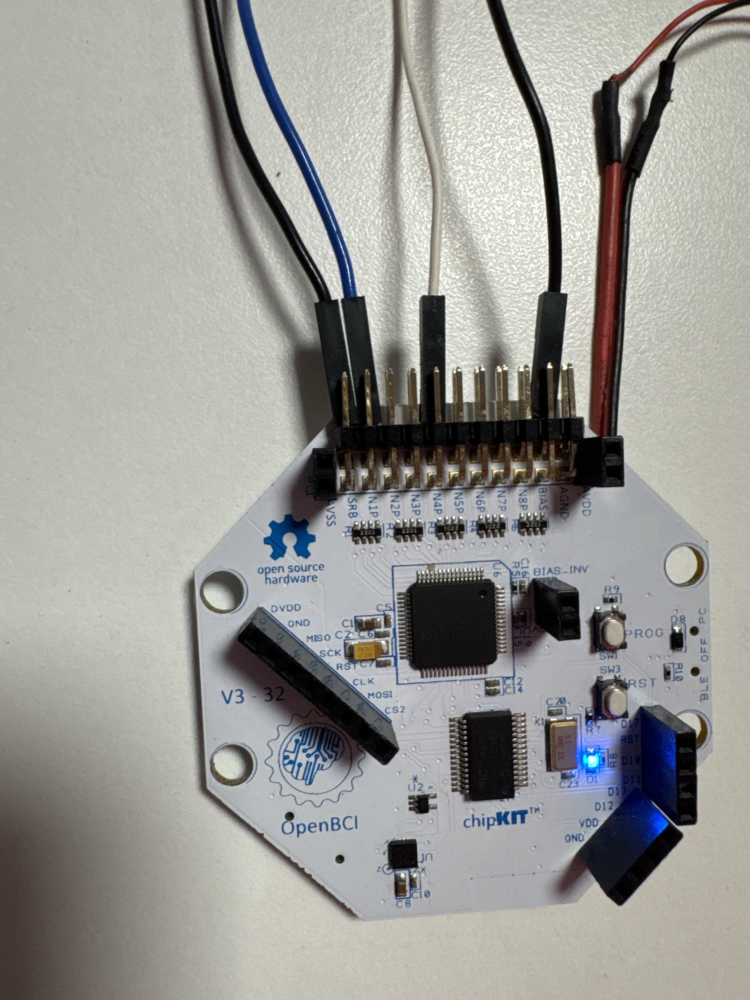

Tools: `tools/validate_board.py <test>` and `test_signal_check.py`; results are saved in `tools/runs/validate_*`. One-page summary: `python tools/validate_board.py report`.

## Step 1: check the machine itself (no body involved)

Like checking a weighing scale with a known 1 kg weight before weighing anything else.

- **Integrity**: is every data sample arriving, on time and in order? The board should send exactly 250 samples per second with no gaps. Missing samples would distort every later analysis.
- **Shorted inputs (noise floor)**: inside the chip, each channel's two inputs are connected to each other, so the true input is exactly 0 V. Whatever the board still shows is its own electronic noise. It must be far below brain-signal size (target ≤ 1.5 µV).
- **Internal test signal**: the amplifier chip (ADS1299) can generate a square wave of known size (±1,875 µV) and known timing (one cycle every 1.024 s). If the board reports exactly that, its **µV scale and timing are proven correct**. Comparing all channels shows whether they measure identically.
- **External short**: an electrode and both ear clips clipped onto the same piece of metal. Like the shorted test, but it also checks the wires, clips and connector pins.

| Test | Status | Date | Key result | Pass criteria |
|---|---|---|---|---|
| Integrity (rate, dropped data, timestamps) | ✅ PASS | 2026-10-03 21:22 | 250.0 Hz, 0 dropped, 0 backwards | 250 ± 0.5 Hz, < 0.1 % dropped |
| Shorted inputs (amplifier noise floor) | ✅ PASS | 2026-10-03 21:40 | ch1/ch2 noise 0.10 µV, 50 Hz 0.03 µV | ≤ 1.5 µV, ≤ 1.0 µV |
| Internal test signal, direct to board (all 8 ch) | ✅ PASS | 2026-10-03 22:12 | ±1,870–1,872 µV (0.25 % off), timing exact, channels match within 0.115 % | within 2 %, channels within 0.5 % |
| Internal test signal, through the GUI | ✅ PASS | 2026-10-04 00:47 | ±1,870 µV, 1.024 s, ch1–ch2 match 0.018 % | same |
| Square wave visible on the GUI screen | ✅ Done | 2026-10-04 01:17 | clean ±1,850–1,900 µV on all 8 channels | — |
| External short (dry electrode + SRB + BIAS clipped on one metal key) | ✅ PASS | 2026-10-04 02:22 | ch1 noise 0.13 µV, 50 Hz 0.14 µV, offset −26 µV, drift 0.5 µV; confirmed hands-free 02:27:53–02:28:12 (0.12 µV, 0.10 µV hum, 20 s) | ≤ 1 µV, ≤ 1 µV, drift ≤ 50 µV |

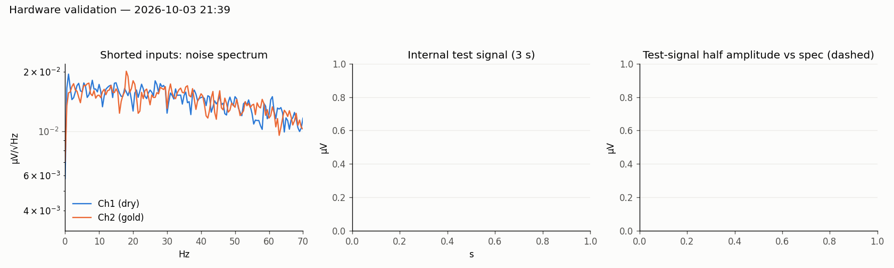

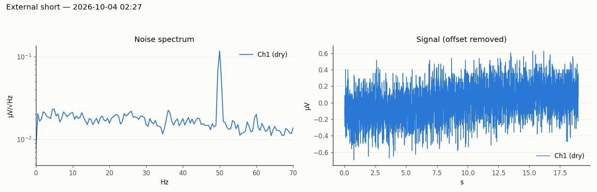

**Step 1 complete ✅:** the hardware measures accurately: very low noise, correct µV scale, exact timing, all channels matched. The external short shows the electrode lead, clips and pins add essentially nothing (0.13 µV vs 0.10 µV internal), so any larger noise we see with electrodes comes from skin contact, movement or the environment, not the hardware.

## Step 2: check against an independent device

- **ECG vs pulse oximeter**: electrodes on both wrists record the heart's electrical signal (ECG). At the same moment, a finger pulse oximeter measures heart rate a completely different way (light through the finger). If both devices agree within about 3 beats per minute, the board is recording a real body signal accurately. We also check the heartbeat has the textbook ECG shape (P wave, QRS spike, T wave at the right timing).

| Test | Status | Date | Key result |
|---|---|---|---|
| ECG vs pulse oximeter, dry electrode (repaired) | ✅ PASS (short run) | 2026-10-05 00:04:01–00:04:29 | ECG 81.8 bpm vs oximeter 80.3 bpm, mean difference **1.6 bpm** (max 4.8) over 22 s; 40 beats, 100 % clean, SNR 21, shape match 0.98. Oximeter read from a phone video. Earlier run (4 Oct 23:26) lost contact 24 % of the time; contact still drops out after ~30 s, so a strap is needed for long recordings |
| ECG vs pulse oximeter, gold electrode | ✅ PASS | 2026-10-04 14:03–14:13 | 810 beats, 100 % clean, 80.6 bpm average, SNR 46.9, textbook P-QRS-T; live dashboard 8-s average matched the pulse oximeter (checked by eye). Gold electrode was on the channel 1 lead |
| ECG vs pulse oximeter, gold electrode (filmed oximeter) | ✅ PASS | 2026-10-05 00:14:34 (+56 s) | ECG 85.0 bpm vs oximeter 84.5 bpm, mean difference **1.5 bpm** (max 2.9) over 17 readings; ECG followed the oximeter as heart rate rose 78 → 89 bpm. 112 beats, 100 % kept, never railed; SNR 8.5 (lower than the 4 Oct gold run's 47, so contact was weaker this time) |

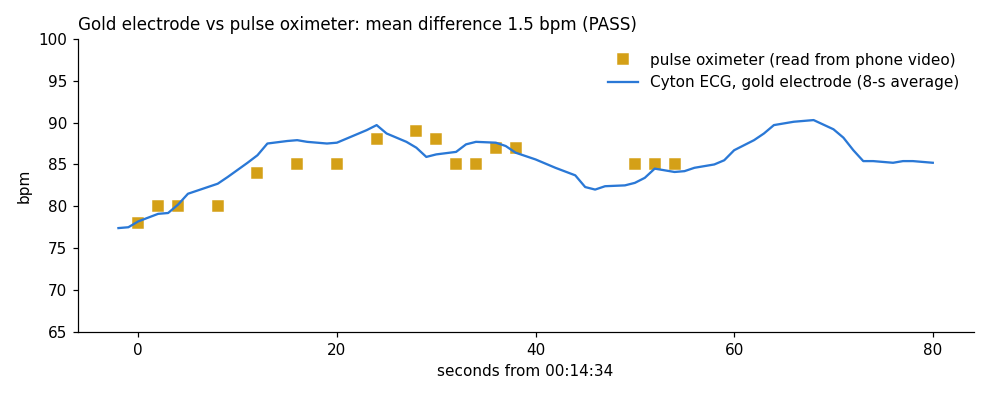

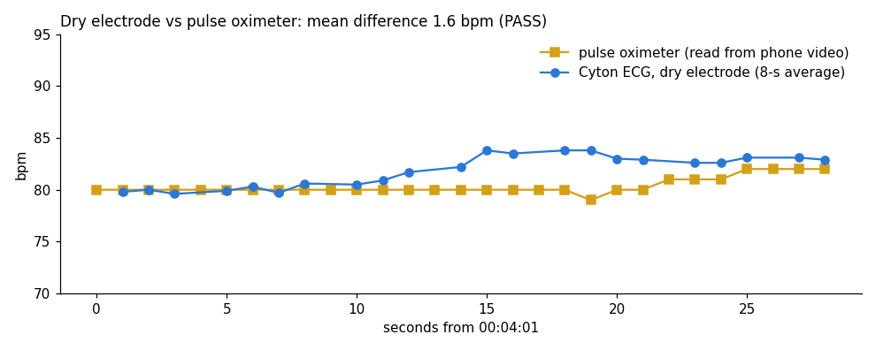

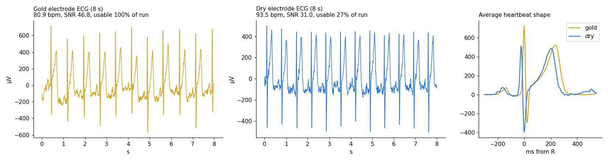

**Dry vs gold (4 Oct):** both electrodes record the same real heartbeat with a textbook shape, so the board and the dry electrode itself work. The difference is **stability**: the gold cup stayed in contact for 10 minutes; the dry electrode kept lifting off the skin, which makes the channel jump to its limit (railed). Fix: a tight strap and a little moisture under the dry electrode.

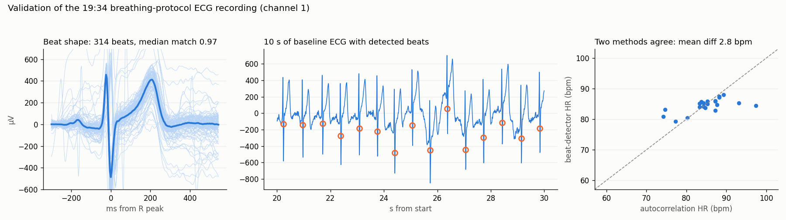

## Step 3: prove the signals are real (cause → effect)

You do something on cue, and the signal must change **only when you do it**. Random noise can't line up with your actions, so this proves the signal is real.

- **Blinks**: electrodes on the forehead; blink 10 times when told. Exactly 10 large spikes should appear, at exactly those moments (eye movement).
- **Jaw clench**: clench your jaw when told. A burst of fast muscle activity should appear only while clenching. Shows muscle noise is detected (and must later be avoided).
- **Alpha rhythm**: electrodes at the back of the head. When you close your eyes, the brain's visual area produces an 8–13 Hz "alpha" rhythm that shrinks when you open them. The classic proof that you're recording **real brain activity**.
- **SSVEP**: look at a screen flickering at exactly 12 Hz (then 15 Hz). The visual cortex follows the flicker, so a peak should appear at exactly that frequency. The strongest proof: noise can't produce a peak at precisely the screen's frequency.

| Test | Status | Date | Key result |
|---|---|---|---|
| Blinks on cue (forehead), dry electrode | ✅ PASS | 2026-10-08 01:30 | 10/10 cued blinks detected, 1 uncued (allowed ≤ 2). Blinks are large, −300 to −600 µV, about 1.8 s after the spoken cue (speech start-up + reaction time). Room hum on the dry electrode was high (~300 µV at 50 Hz) but filtered out |
| Blinks on cue, **dry (ch1) and gold + Ag/AgCl gel (ch2) at the same time** | ✅ PASS | 2026-10-09 23:56 | Dry 10/10, gold 9/10 cued blinks (gold missed cue 2 because that blink came early); 1 uncued each. Blink shape on the two electrodes correlates **0.95**. Same blink size on both (~300 µV), but at rest gold had far less noise (50 Hz hum 4–11 µV vs ~300 µV dry) |
| Jaw clench (muscle), dry electrode | ✅ PASS | 2026-10-08 21:23 | Muscle activity (20–45 Hz) **6.8×** higher while clenching than at rest (need ≥ 5×): 23.6 µV vs 9.1 µV. A clear burst follows each of the 3 cues, ~1.5 s after the spoken word |
| Jaw clench, **dry (ch1) and gold + gel (ch2) at the same time** | ✅ PASS | 2026-10-10 01:14 | Muscle power while clenching vs rest: dry **5.9×**, gold **6.9×** (need ≥ 5×). The two muscle traces rise and fall together after every cue. Synced face + EEG video recorded (kept private) |
| Alpha, eyes closed vs open (back of head, O1), dry electrode in headset | ✅ PASS | 2026-10-08 22:43 | Alpha (8–13 Hz) power **4.3× higher with eyes closed** (need ≥ 2×); peak at **9.5 Hz**; 98.7 % clean epochs. Alpha rose in all 3 eyes-closed blocks and dropped every time the eyes opened. First attempt failed (×1.3) because the dry pins sat on thick hair; parting the hair and wetting the scalp fixed it |
| Alpha, **dry (ch1, O1) and gold + gel (ch2, Oz) at the same time** | ✅ PASS | 2026-10-11 01:43 | Eyes-closed / open alpha power: dry **4.3×**, gold **5.7×** (need ≥ 2×); both peak at **9.5 Hz**; 96 % clean epochs; the two alpha envelopes correlate 0.77. Gold picks up more alpha (7.9 vs 5.2 µV eyes closed) with less hum (6 vs 26 µV) |
| SSVEP, **dry (ch1) and gold + gel (ch2) together** | ⚠️ PARTIAL (retest) | 2026-10-11 02:19 | 12 Hz detected on both (SNR 3.0 dry, 2.1 gold, need ≥ 2; only during the flicker), 15 Hz not (1.2, 1.6); CCA 56 %. Much weaker than the dry-only run on 8 Oct (SNR 19 / 15), most likely because the electrodes sat higher than O1/Oz. An earlier run at 02:08 failed completely because both ear clips had come off (both channels showed the same floating reference) |
| SSVEP retest (30-s flickers), dry O1 + gold Oz | ✅ PASS (dry) · ⚠️ partial (gold) | 2026-10-11 19:00 | **Dry passes everything**: SNR 3.3 at 12 Hz, 3.7 at 15 Hz, no peak at rest, CCA 83 % on its own. Gold: 12 Hz yes (2.7), 15 Hz weak (1.4) with more muscle noise; adding gold lowers the 2-channel CCA to 64 %. Fixes that made it work: electrodes moved down to the lowest back ring, fan off (removed a 3.5 Hz interference), ear clips firmly on |
| SSVEP 12 / 15 Hz flicker (O1), dry electrode | ✅ PASS | 2026-10-08 22:52 | Peak at exactly the flicker rate: **SNR 19.1 at 12 Hz, 15.0 at 15 Hz** (need ≥ 2); no peak during rest (0.72 and 1.25). Harmonics at 24 and 30 Hz also visible. A standard SSVEP decoder (CCA) picked the right frequency in **97.1 %** of 2-s windows (need ≥ 80 %). Screen measured at exactly 60 Hz, so 12 Hz = 5 frames, 15 Hz = 4 frames |

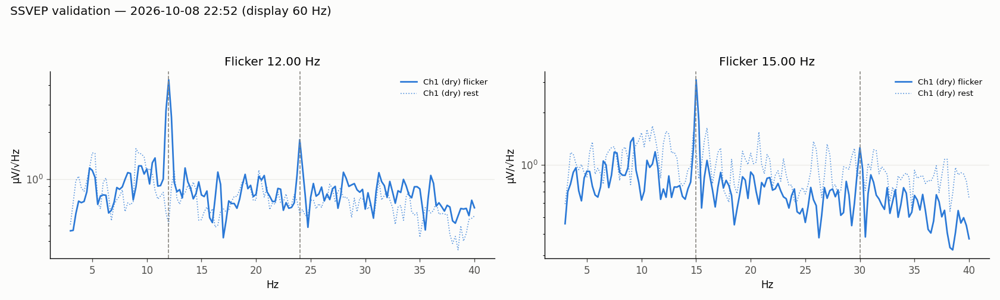

**Step 3 complete ✅:** every cause-and-effect test passed with the dry electrode: blinks appear only on cue, jaw muscle noise only when clenching, the alpha rhythm only with eyes closed, and a brain response at exactly the frequency on the screen. The board records real eye, muscle and **brain** signals.

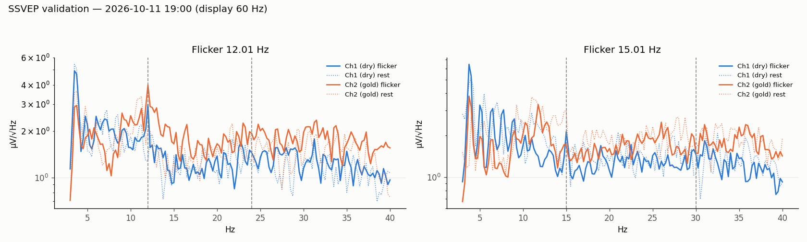

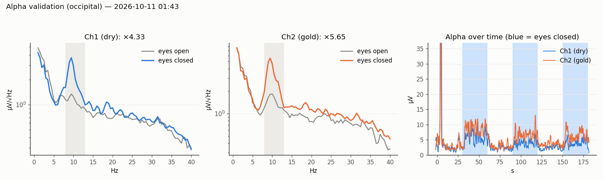

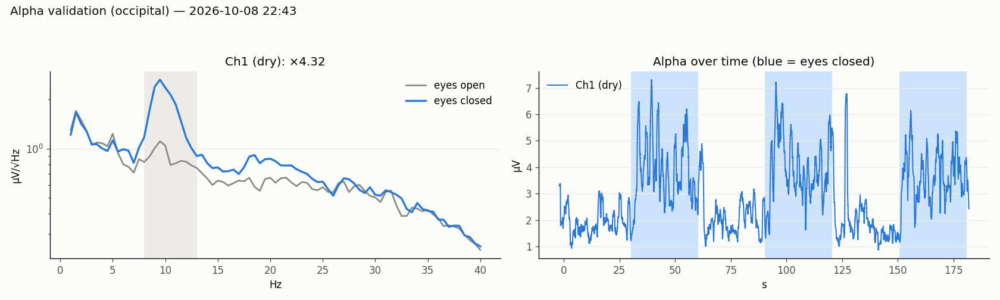

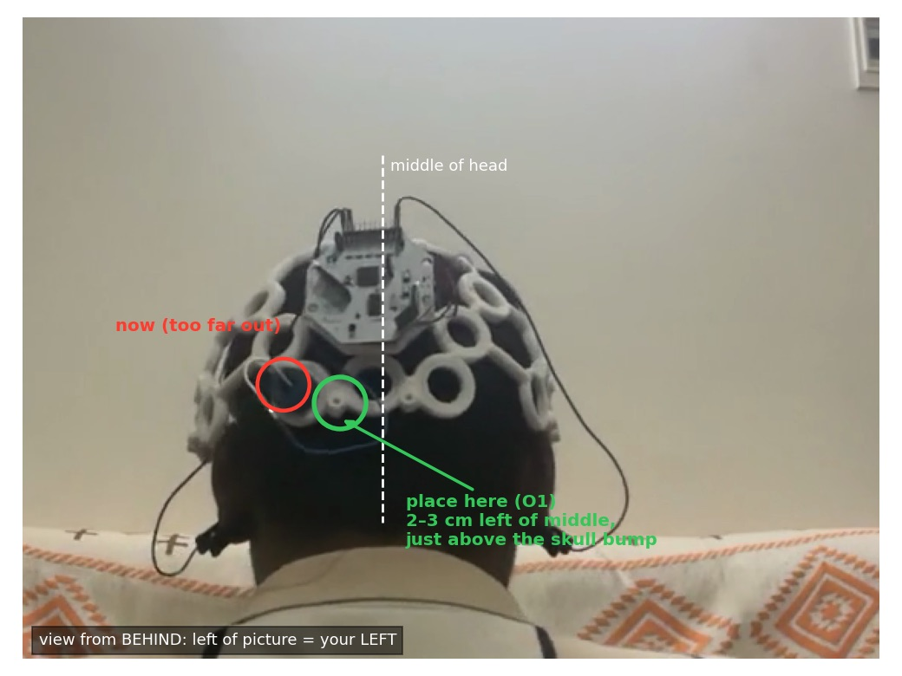

**Tip for dry electrodes on the back of the head:** thick hair stops the pins from touching the scalp. Part the hair at the spot, wet the scalp with a little water or saliva, then twist the electrode back and forth while pressing. This raised the alpha reactivity from ×1.3 to ×4.3 and cut mains hum from ~130 µV to ~28 µV.

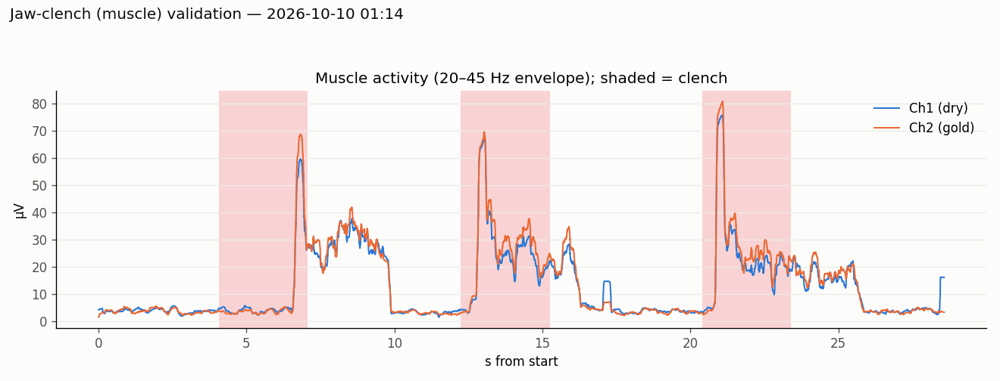

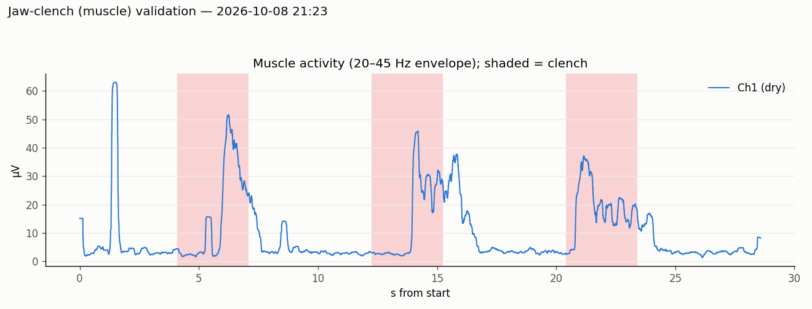

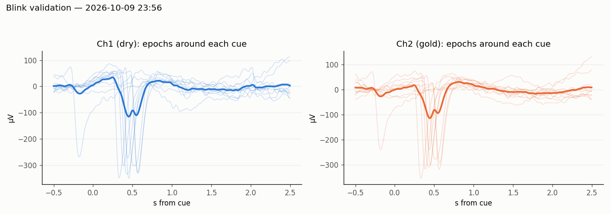

**Why the gold channel first read as a flat line (9 Oct):** a gold cup on dry skin builds up a large steady voltage (DC offset, ~175,000 µV) that slowly creeps past the board's ±187,500 µV limit, so the channel sits flat at the limit, exactly like an unplugged input. It is not a broken wire. Fix: fill the cup with gel (or water/saliva) and press it on; or lower the channel gain from x24 to x8 for more headroom. With Ag/AgCl gel the offset fell to ~143,000 µV and the signal was clean.

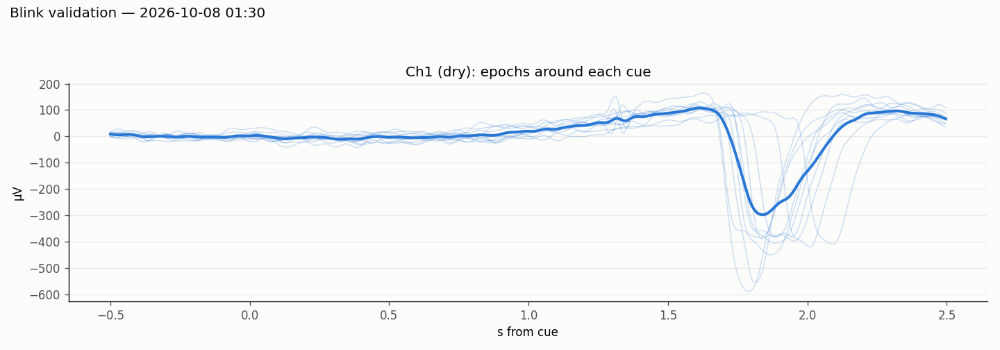

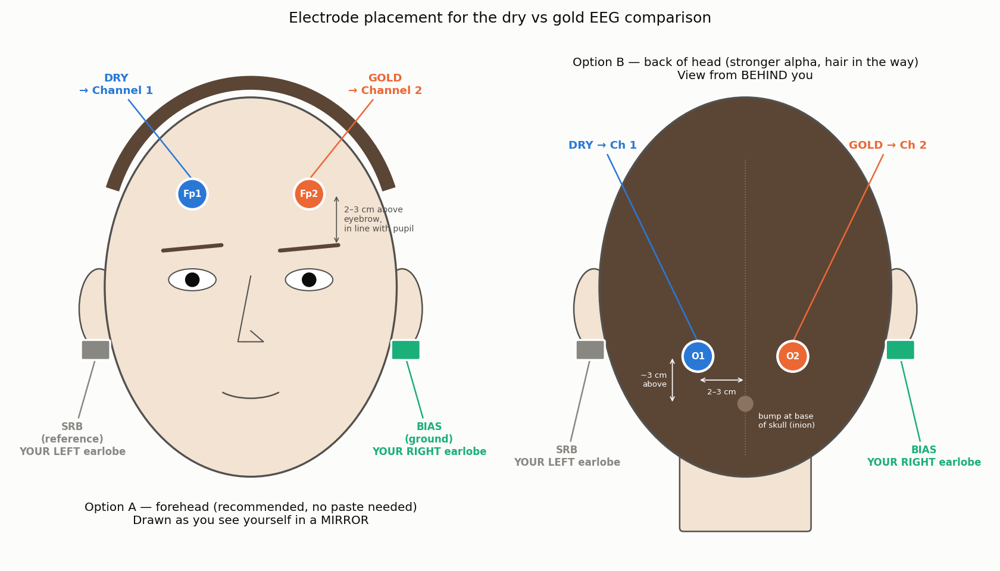

Until the dry electrode is repaired, Step 3 uses the **gold cup electrode on channel 1**. The dry electrode will be compared later.

### What frequencies do blinks and jaw clenches produce? (8 Oct, dry electrode on forehead)

Each blink and clench was compared with the quiet moments in between (`tools/event_spectra.py`, 50 Hz mains removed). This tells us which frequencies each artifact pollutes, which matters later when we look for real brain signals.

| Frequency band | Blink vs rest | Jaw clench vs rest |
|---|---|---|
| 0.5–4 Hz (slow) | **232 vs 7 µV (×34)** | not meaningful (rest windows included natural blinks) |
| 4–8 Hz (theta) | 52 vs 4 µV (×12) | ×1.2 |
| 8–13 Hz (alpha) | 18 vs 3 µV (×6) | ×1.6 |
| 13–30 Hz (beta) | ×2.6 | **21 vs 4.5 µV (×4.7)** |
| 30–45 Hz | ×1.6 | **20 vs 2.2 µV (×9)** |
| 55–100 Hz | ×1.7 | **27 vs 1.8 µV (×15)** |

- **Blinks are slow and huge**: most of their energy is below 4 Hz, spilling into theta and alpha. Eye activity can fake brain rhythms below ~13 Hz, so EEG analysis must remove blinks or avoid frontal sites.
- **Jaw clenches are fast and broad**: muscle (EMG) energy spreads from ~15 Hz up to 100 Hz and beyond. It drowns out beta and gamma, which is exactly where motor-imagery signals live (mu 8–13 Hz, beta 13–30 Hz). So the jaw, face and neck must stay relaxed during BCI recordings.
- **Alpha (8–13 Hz) is the cleanest window**: barely touched by clenching and only moderately by blinks, which is why alpha is the next test.

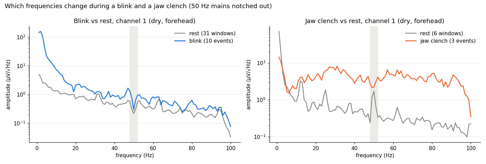

## Overall result

All 9 validation tests pass: the board's own accuracy (integrity, noise floor, test signal, external short), an independent device (ECG vs pulse oximeter, dry and gold), and cause and effect (blinks, jaw, alpha, SSVEP). One-page summary: `python tools/validate_board.py report`.

## How our numbers compare with published references

| Test | Published reference | Ours | Verdict |
|---|---|---|---|
| Noise floor, inputs shorted | A working Cyton reads 0.09–0.14 µV RMS [1] | 0.10 µV | ✅ in range |
| Signal accuracy vs research amplifier | Cyton vs Brain Products BrainAmp, recorded simultaneously: r² 97–100 %, mean difference ~0.8 µV, noise not worse than a reference dataset [2] | Internal test signal 0.25 % off spec; channels matched within 0.1 % | ✅ consistent (we have not recorded against a second amplifier) |
| Alpha, eyes closed / open | Alpha modulation ratio ~4.9, wet and dry similar [3] | 2.4–5.7× (dry 2.4–4.3, gold 4.3–5.7) | ✅ normal range |
| SSVEP, dry vs wet | 102 people, 12 targets: accuracy 83 % wet vs 63 % dry [4] | 2 targets: dry 83–97 % | ⚠️ not directly comparable (2 targets is easier); "dry is weaker on average" matches |
| SSVEP SNR (narrow-band, peak / neighbours) | Rule of thumb: < 2 not detectable, 2–5 usable, 5–10 good, > 10 excellent | dry 15–19 (8 Oct), 3.3–3.7 (11 Oct) | ✅ usable to excellent |
| Gamma / fast responses | Detected with OpenBCI, but more noise and bad trials than Brain Products [5] | not tested | — |
| ECG vs pulse oximeter | Clinical agreement target: within ~3 bpm | 1.5–1.6 bpm | ✅ |

References:
1. [Self-Noise of OpenBCI (OpenBCI community)](https://openbci.com/community/self-noise-of-openbci/)
2. [Comparing Simultaneous Scalp EEG Recordings from the OpenBCI Cyton and Brain Products BrainAmp (Sensors 2026)](https://pmc.ncbi.nlm.nih.gov/articles/PMC12944456/)
3. [Rapid Fabrication of Low Impedance, 3D Dry Electrodes for Physiological Sensing (arXiv)](https://arxiv.org/pdf/2201.03612)
4. [An Open Dataset for Wearable SSVEP-Based Brain-Computer Interfaces (Sensors 2021)](https://pmc.ncbi.nlm.nih.gov/articles/PMC7916479/)
5. [Stimulus-induced narrow-band gamma oscillations recorded with an open-hardware low-cost EEG amplifier (PLOS ONE)](https://journals.plos.org/plosone/article?id=10.1371%2Fjournal.pone.0279881)

Public datasets for side-by-side comparison: [OpenBCI Cyton eyes open/closed (Zenodo)](https://zenodo.org/records/10423897), [wearable SSVEP, wet + dry, 102 subjects](https://pmc.ncbi.nlm.nih.gov/articles/PMC7916479/).

## Earlier informal checks (before the formal tests)

| Check | Date | Result |
|---|---|---|
| Unconnected inputs, mains (50 Hz) pickup, channels hitting the limit | 2026-10-01 | floor ~2 µV; long loose wires act as antennas for 50 Hz mains hum |
| ECG: same hand vs opposite wrists | 2026-10-02 | same hand weak (~135 µV); opposite wrists clear, 80 bpm |
| Breathing protocol (`breathing_hr.py`) | 2026-10-02 19:34 | slow breathing swings heart rate ~28 bpm; 306/316 beats clean |
| ECG recording validation | 2026-10-02 | textbook P-QRS-T shape; two heart-rate methods agree within 2.8 bpm |
| Dry vs gold electrode ECG (no paste) | 2026-10-02 21:45 | dry cleaner (signal-to-noise 42.6 vs 18.8); gold drifted 10× more without paste |
| Same-spot skin test: SRB + BIAS + dry electrode on one fingertip | 2026-10-04 02:15 | 50 Hz only ~1.5 µV (BIAS cancels hum well); remaining 10–40 µV is slow (<2 Hz) drift from the dry electrode-skin contact; offset drifting 7,000→16,000 µV. Not a metal short, so not a board pass/fail |

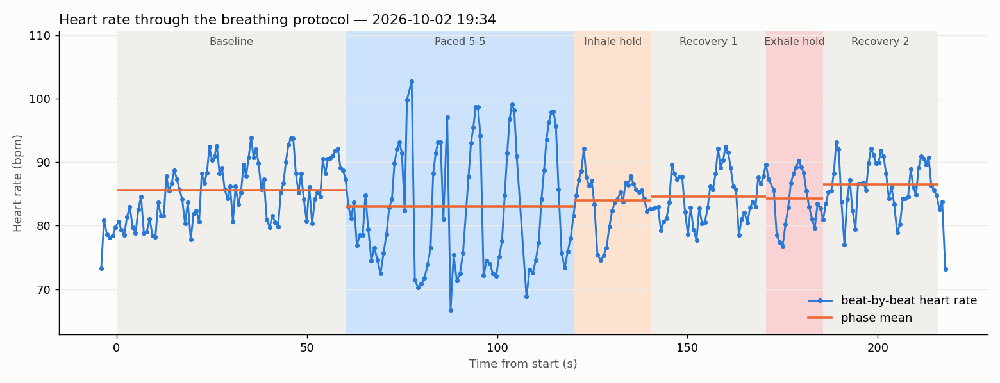

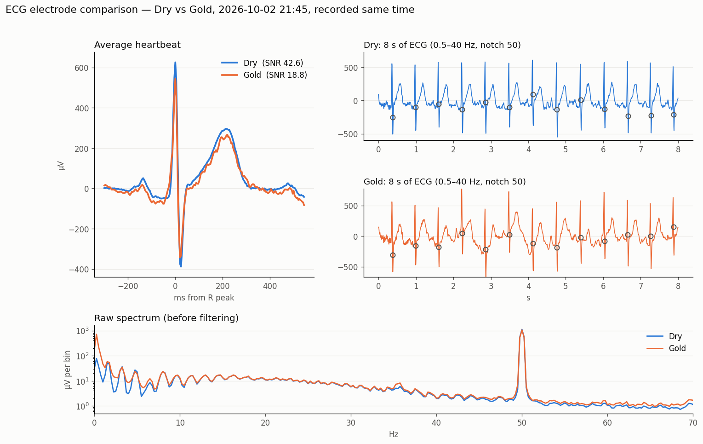

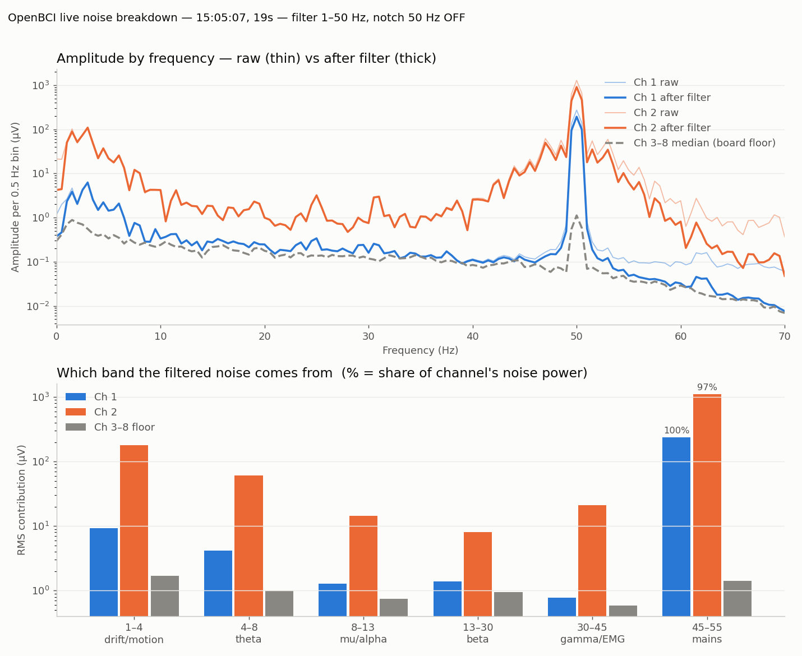

## Glossary

- **µV (microvolt)**: one millionth of a volt. Brain signals are ~10–50 µV.
- **Channel**: one electrode's recording. The Cyton has 8.
- **SRB (reference)**: the "zero point" ear clip; every channel = electrode − SRB.
- **BIAS (ground)**: second ear clip that actively cancels electrical noise from the body.
- **50 Hz hum**: interference from mains electricity (India uses 50 Hz); removed with a "notch" filter.
- **Railed**: a channel stuck at the board's limit (±187,500 µV), usually because an electrode isn't touching skin.
- **ECG**: the heart's electrical signal. **EEG**: the brain's. **EMG**: muscles'.

## Known quirks / gotchas

- The GUI applies Hardware Settings only after **Stop stream → change → Send → Start stream**; starting a new session resets all channels to Normal.
- The GUI's "Test" input type does **not** turn on the test-signal generator. Use Expert Mode (Settings → Turn Expert Mode On) → Hardware Settings → **Send Custom Command** `-` (1× slow), `=` (1× fast), `[`/`]` (2×), `d` to reset. Check `sending - to the board` in `~/Documents/OpenBCI_GUI/Console_Data/Brainflow_*.txt`.
- To see the raw square wave: Filters → Notch None, click the **All** circle (grey = bandpass off), Vert Scale Auto.
- Growing "Lost N samples" warnings followed by "No new data in 5 s" means the board battery is running flat: swap or charge the LiPo.
- Unconnected inputs look quiet but sit far from 0 µV; truly shorted inputs read ~0 µV.
